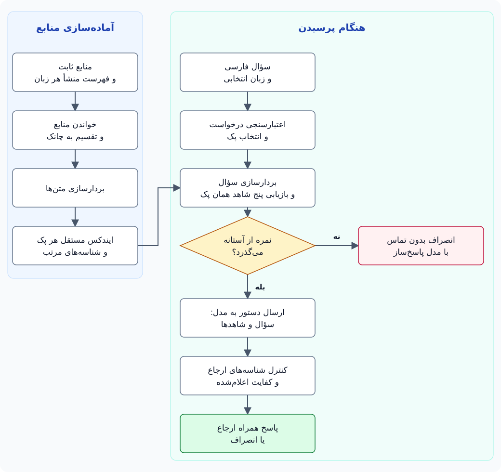

# Persian Technical RAG

[English](README.md) | **فارسی**

<p align="center">
  <strong>سؤال فارسی. منابع مشخص. پاسخ قابل‌بررسی.</strong><br>
  یک کمک‌معلم فنی با کتابِ باز، و یک مسیر پژوهشی برای سنجش کیفیت بازیابی.
</p>

<p align="center">
  
  
  
  
  
</p>

**Persian Technical RAG** یک نمونهٔ آموزشی و پژوهشی برای پرسش‌وپاسخ فارسی دربارهٔ
**C، C++، Python و Java** است. برنامه به‌جای فرستادنِ تنها سؤال به مدل زبانی،
ابتدا در منابع ثابتِ زبان انتخاب‌شده جست‌وجو می‌کند و متن‌های پیدا‌شده را برای
پاسخ‌سازی در اختیار مدل می‌گذارد. ارجاع‌ها امکان دیدن عنوان، بخش و متن شاهد را فراهم می‌کنند.

**در یک نگاه:** ۴ پک مستقل · ۹۰ سند منبع · ۱٬۰۳۰ چانک · ۳ مدل Embedding پژوهشی · ۱۸۰ سؤال تازهٔ v2

[هدف و قابلیت‌ها](#overview) · [معماری](#architecture) · [ساختار](#structure) · [نتایج](#results) · [شروع سریع](#quickstart) · [پژوهش](#research-guide) · [محدودیت‌ها](#limitations)

> [!IMPORTANT]
> این پروژه **نمونهٔ محلیِ پایان‌نامه و پژوهش** است، نه محصول بی‌نقص یا دستیار
> همه‌چیزدان. ارجاع معتبر به‌تنهایی درستیِ همهٔ ادعاهای پاسخ را تضمین نمی‌کند.
> [محدودیت‌های شناخته‌شده](#limitations) بخشی از معرفی همین نسخه‌اند، نه قابلیت‌هایی که از قبل رفع شده باشند.

<a id="overview"></a>
## هدف پروژه و قابلیت‌ها

هدف، نزدیک‌کردن پاسخ فنی فارسی به یک مسیر **قابل‌ردیابی و قابل‌اندازه‌گیری** است:
دانشجو بتواند شاهد را ببیند و پژوهشگر بتواند جداگانه بسنجد «متن مناسب پیدا شد؟»
و «پاسخ نهایی چه ارجاعی داشت؟».

- **پرسش فارسی و اصطلاح انگلیسی:** نام‌هایی مثل `malloc`، `range` و `inheritance` در ورودی حفظ می‌شوند.
- **منابع جدا برای هر زبان:** هر LanguagePack مجموعهٔ منبع، ایندکس و سؤال‌های خودش را دارد.
- **پاسخ و شاهد کنار هم:** کلیک روی ارجاع، عنوان سند، نام بخش و متن چانک را نشان می‌دهد.
- **مسیر انصراف:** نمرهٔ پایین پیش از تماس با پاسخ‌ساز متوقف می‌شود؛ مدل هم می‌تواند ناکافی‌بودن شاهد را اعلام کند.
- **داشبورد فارسی:** انتخاب زبان، سؤال‌های نمونه، نمایش Markdown، کد و حالت‌های انتظار/خطا.
- **ارزیابی قابل‌ممیزی:** سؤال‌های نسخه‌دار، منشأ شاهد، گزارش JSON و Markdown، و نتیجهٔ مستقل برای هر زبان.
- **مقایسهٔ مدل‌ها:** E5-large، E5-base و BGE-M3 با چانک‌های مشترک، ایندکس‌های جدا و نسخه‌های مشخص پژوهشی.

### دو مسیر؛ دو کاربرد

| مسیر | برای چه کسی؟ | تنظیم اصلی |
|---|---|---|
| داشبورد عملیاتی | دانشجو و نمایش پروژه | `multilingual-e5-large`، ایندکس و آستانهٔ مستقل هر پک |
| آزمایش پژوهشی | مقایسهٔ Embeddingها | سه مدل نسخه‌ثابت، آستانهٔ pooled-v1 هر مدل و سؤال‌های تازهٔ v2 |

انتخاب BGE-M3 در آزمایش، مدل داشبورد را خودکار عوض نمی‌کند. مدل Embedding
برای **پیدا کردن متن** است؛ LLM پاسخ‌ساز برای **نوشتن جواب** استفاده می‌شود.
در این پروژه هیچ‌یک از این مدل‌ها از صفر آموزش داده نمی‌شوند.

<a id="architecture"></a>
## معماری؛ از سند تا پاسخ

**RAG** یعنی پاسخ‌سازی با کمک بازیابی. آماده‌سازی منابع یک مرحلهٔ جداست؛ با
هر سؤال قرار نیست تمام سندها دوباره تقسیم و بردارسازی شوند.



<details>
<summary>کد قابل‌ویرایش نمودار (Mermaid)</summary>

```text
flowchart TD
    subgraph Prepare["آماده‌سازی منابع"]
        A["منابع ثابت + Manifest هر زبان"] --> B["Ingest؛ تقسیم به Chunk"]
        B --> C["Embedding متن‌ها"]
        C --> D["FAISS Index + شناسه‌های مرتب"]
    end
    subgraph Ask["هنگام پرسیدن"]
        E["سؤال فارسی + زبان انتخابی"] --> F["اعتبارسنجی و انتخاب پک"]
        F --> G["Embedding سؤال و Top-5 همان پک"]
        D --> G
        G --> H{"نمره از آستانه می‌گذرد؟"}
        H -->|"نه"| I["Abstain؛ بدون تماس پاسخ‌ساز"]
        H -->|"بله"| J["Prompt؛ سؤال + شاهدها برای LLM"]
        J --> K["کنترل شناسه‌های ارجاع و کفایت اعلام‌شده"]
        K --> L["Answer + Citation یا Abstain"]
    end
```

</details>

سؤال خیلی کوتاه مسیر `clarify` دارد و پک آماده‌نشده `unavailable` می‌دهد؛
این دو شاخه پیش از بازیابی متوقف می‌شوند. انتخاب پک **صریحاً با کاربر** است،
نه تشخیص خودکار زبان برنامه‌نویسیِ سؤال.

| لایه | ابزار یا روش |
|---|---|
| تقسیم متن | قواعد بخش‌محور Markdown در Python |
| بردارسازی | Sentence Transformers و مدل‌های چندزبانه |
| جست‌وجو | FAISS `IndexFlatIP` روی بردارهای نرمال‌شده |
| پاسخ‌سازی | رابط Chat سازگار با OpenAI؛ تنظیم‌پذیر از محیط |
| وب | FastAPI + Uvicorn؛ HTML/CSS/JavaScript بدون Framework فرانت‌اند |
| ارزیابی | pytest، امتیازدهی شناسه‌ای، Bootstrap جفت‌شده و Sweep توصیفی |

مسیر اصلی پاسخ در [`src/web/app.py::_ask`](src/web/app.py)، بازیابی در
[`Retriever.retrieve`](src/qa/retriever.py) و ساخت Prompt/ارجاع در
[`compose_answer`](src/qa/answer.py) قرار دارد. Framework عامل‌محور یا Agent خودگردان در این مسیر نداریم.

<a id="structure"></a>
## ساختار مخزن و منابع

```text
Persian-Technical-RAG/
├── src/
│   ├── ingest/                 # خواندن منابع، Chunker و Writer
│   ├── index/                  # Embedding، FAISS و Cache پژوهشی
│   ├── qa/                     # Retriever، Prompt، Provider و انصراف
│   ├── web/                    # API، صفحهٔ فارسی و فایل‌های رابط
│   └── eval/                   # اعتبارسنجی سؤال، تنظیم آستانه و مقایسه
├── data/
│   ├── corpus/                 # منابع ثابت و manifest.<lang>.json
│   ├── index/<lang>/           # ایندکس عملیاتی، IDs و چانک‌ها
│   ├── research/embedding-compare/<model>/<lang>/
│   └── eval/                   # v1، v2، Pilot، Calibration و گزارش‌ها
├── tests/
│   ├── unit/
│   ├── contract/
│   └── integration/
├── specs/                      # خواسته‌ها، طرح، تصمیم‌ها و تسک‌های 001–003
├── docs/                       # مقاله، مهاجرت و شواهد اجرای پروژه
├── .specify/                   # اصول پروژه و ابزارهای برنامه‌ریزی توسعه
├── requirements.txt
└── pytest.ini
```

**Manifest** فهرست منشأ، تاریخ و برچسب مجوز منابع است. **Chunk** تکهٔ قابل‌بازیابی
متن است؛ یک سند می‌تواند چندین چانک داشته باشد.

| پک | شناسه | منابع | چانک | ترکیب | Snapshot |
|---|---|---:|---:|---|---|
| C | `c` | ۵۲ | ۵۰۳ | ۱۲ جزوهٔ مالک، ۳۵ مرجع cppreference، ۵ مرجع glibc | 2026-09-23 |
| C++ | `cpp` | ۱۳ | ۲۰۱ | ۱ جزوهٔ مالک و ۱۲ مرجع cppreference | 2026-10-16 |
| Python | `python` | ۹ | ۲۵۳ | مستندات رسمی انگلیسی Python | 2026-10-16 |
| Java | `java` | ۱۶ | ۷۳ | آموزش‌های انگلیسی Oracle | 2026-10-16 |

Python و Java عمداً منابع انگلیسی دارند؛ این بخش از پروژه بازیابیِ سؤال فارسی
از شاهد انگلیسی را هم می‌سنجد. فهرست دقیق در [Manifestهای منابع](data/corpus/) است.

**چه چیزی در Git هست؟** منابع، سؤال‌ها، IDs، تنظیم‌ها و گزارش‌های رسمی v2.
وزن مدل‌ها، `chunks.jsonl`، `faiss.index` و آرایه‌های `embeddings-*.npy` فایل‌های
دریافتنی/بازساختنی‌اند؛ در مخزن نگهداری نمی‌شوند. [قواعد ignore](.gitignore) مرجع این تفکیک است.

<a id="results"></a>
## نتایج ثبت‌شدهٔ پروژه

این بخش خروجی **اجراهای ذخیره‌شده** است، نه وعدهٔ نتیجهٔ یکسان در هر اجرای
آینده. نسخهٔ سؤال، آستانه و مسیر اجرا را همراه عدد بخوانید.

### مسیر عملیاتی v1 — اجرای ۲۰۲۶-۱۰-۲۲

هر پک ۳۰ سؤال دارد: ۲۰ درون‌پیکره، ۵ سؤال فارسی/انگلیسیِ آمیخته و ۵ خارج‌پیکره.
سه Probe مستقلِ بین‌پکی هم جدا ارزیابی شده‌اند؛ هر گزارش جدول زیر ۳۳ ردیف و صفر خطای مدل دارد.

| پک | Hit@5 روی ۲۵ سؤال پاسخ‌دادنی | دقت ارجاع پاسخ‌ها | انصراف OOC | Probe بین‌پکی | گزارش |
|---|---|---:|---|---|---|
| C | 25/25 — 1.000 | 0.657 | 5/5 | 3/3 | [C v1](data/eval/c/reports/2026-10-22-0748-c-v1.md) |
| C++ | 15/25 — 0.600 | 0.812 | 5/5 | 3/3 | [C++ v1](data/eval/cpp/reports/2026-10-22-0753-cpp-v1.md) |
| Python | 19/25 — 0.760 | 0.602 | 5/5 | 3/3 | [Python v1](data/eval/python/reports/2026-10-22-0758-python-v1.md) |
| Java | 23/25 — 0.920 | 0.706 | 5/5 | 3/3 | [Java v1](data/eval/java/reports/2026-10-22-0802-java-v1.md) |

- **Hit@5:** حداقل یک شاهد موردانتظار در پنج نتیجهٔ اول پیدا شده است؛ درستیِ متن پاسخ را نمی‌سنجد.
- **دقت ارجاع:** میانگین امتیاز شناسه‌های موردانتظار روی پاسخ‌های تولیدشده؛ داوری معناییِ تمام جمله‌ها نیست.
- **OOC:** سؤال خارج از منابع؛ انصراف درست باید بدون Citation باشد.
- **۳/۳ Probe:** نتیجهٔ همین سه سؤال مشخص است، نه اثبات رد همهٔ سؤال‌های زبان اشتباه.

[گزارش مهاجرت C](docs/MIGRATION-RESULTS.md) هم تفاوتِ حفظ نتایج بازیابی با
تغییرپذیری Precision پاسخ‌ساز را جدا توضیح می‌دهد.

### مسیر پژوهشی v2 — مقایسهٔ سه Embedding

**۱۸۰ سؤال تازه**: برای هر پک ۲۸ درون‌پیکره + ۱۰ آمیخته + ۷ خارج‌پیکره.
آستانهٔ هر مدل پیش از v2، از چهار v1 با مجموع ۱۰۰ سؤال پاسخ‌دادنی و ۲۰ OOC
انتخاب شده است. سؤال‌های Pilot و v2 برای تنظیم این آستانه استفاده نمی‌شوند.

| مدل پژوهشی | بُعد بردار | سقف Token | پیشوند سؤال / منبع |
|---|---:|---:|---|
| `e5-large` | 1024 | 512 | `query: ` / `passage: ` |
| `e5-base` | 768 | 512 | `query: ` / `passage: ` |
| `bge-m3` | 1024 | 8192 | بدون پیشوند |

نسخه‌های دقیق و مجوز مدل‌ها در [Registry](data/eval/model-comparison/models.json)
ثبت‌اند. آزمایش فقط بردار Dense نرمال‌شده را مقایسه می‌کند؛ حالت Sparse یا چندبرداری BGE-M3 وارد این مقایسه نشده است.

**Hit@5 — اجراهای رسمی v2 ثبت‌شده در ۲۰۲۶-۱۰-۲۵:**

| پک | E5-large از ۳۸ | E5-base از ۳۸ | BGE-M3 از ۳۸ | تصمیم همان زبان | شواهد |
|---|---|---|---|---|---|
| C | 26/38 | 21/38 | 27/38 | نامشخص | [جدول](data/eval/c/reports/v2/comparison.v2.md) · [JSON](data/eval/c/reports/v2/comparison.v2.json) |
| C++ | 13/38 | 17/38 | 29/38 | bge-m3 | [جدول](data/eval/cpp/reports/v2/comparison.v2.md) · [JSON](data/eval/cpp/reports/v2/comparison.v2.json) |
| Python | 24/38 | 19/38 | 26/38 | نامشخص | [جدول](data/eval/python/reports/v2/comparison.v2.md) · [JSON](data/eval/python/reports/v2/comparison.v2.json) |
| Java | 33/38 | 32/38 | 38/38 | bge-m3 | [جدول](data/eval/java/reports/v2/comparison.v2.md) · [JSON](data/eval/java/reports/v2/comparison.v2.json) |

<details>
<summary><strong>دقت ارجاع و دو نوع انصراف v2؛ هر ۱۲ ترکیب مدل و پک</strong></summary>

| پک | مدل | تعداد Answer | دقت ارجاع | انصراف Gate روی OOC | انصراف E2E روی OOC |
|---|---|---:|---:|---|---|
| c | e5-large | 29 | 0.810 | 1/7 | 7/7 |
| c | e5-base | 24 | 0.833 | 1/7 | 7/7 |
| c | bge-m3 | 27 | 0.772 | 6/7 | 7/7 |
| cpp | e5-large | 14 | 0.750 | 0/7 | 7/7 |
| cpp | e5-base | 17 | 0.912 | 0/7 | 7/7 |
| cpp | bge-m3 | 25 | 0.880 | 3/7 | 7/7 |
| python | e5-large | 18 | 0.833 | 6/7 | 7/7 |
| python | e5-base | 12 | 0.792 | 4/7 | 7/7 |
| python | bge-m3 | 18 | 0.861 | 7/7 | 7/7 |
| java | e5-large | 18 | 0.889 | 6/7 | 7/7 |
| java | e5-base | 14 | 0.845 | 7/7 | 7/7 |
| java | bge-m3 | 27 | 0.920 | 7/7 | 7/7 |

Precision، میانگینِ امتیاز **هر پاسخ** است، نه نسبت کل ارجاع‌های درست به کل
ارجاع‌ها. تعداد Answer را هم ببینید؛ پاسخ‌ندادنِ بیشتر می‌تواند تفسیر Precision را عوض کند.
Gate فقط نمره را می‌سنجد؛ انصراف نهایی می‌تواند از اعلام ناکافی‌بودن شاهد توسط LLM هم سود ببرد.
CIها، تعداد Citationها، Sliceهای آمیخته/زبان شاهد و اختلاف‌های زوجی در جدول‌های رسمی بالا آمده‌اند.

</details>

قاعدهٔ تصمیم بر ۱۰٬۰۰۰ بازنمونهٔ جفت‌شده با Seed=`20261022`، بازهٔ اطمینان
۹۵٪ معیارها و بازهٔ حدود ۹۸٫۳۳٪ اختلاف سه زوج در هر زبان تکیه دارد. بزرگ‌ترین
میانگین به‌تنهایی برنده نمی‌سازد؛ **نامشخص** هم به معنی برابری قطعی مدل‌ها نیست.

**برندهٔ جهانی اعلام نشده است.** تحلیل چهارزبانهٔ Pooled فقط اکتشافی است.
هفت OOC در هر زبان کم است و حتی نتیجهٔ ۷/۷ تضمین عملکرد روی سؤال‌های تازه نیست.
عددهای v1 و v2 هم به دلیل سؤال‌ها و آستانه‌های متفاوت، مقایسهٔ مستقیمِ قبل/بعد نیستند.

جزئیات روش، محدودیت‌ها، منشأ پاسخ‌های مرجع و پیوند هر دوازده زوج گزارش در
[مقالهٔ مقایسه](docs/EMBEDDING-COMPARISON.md) قرار دارد.

<a id="quickstart"></a>
## راه‌اندازی سریع؛ اول پک C را اجرا کنید

این مسیر کمترین مراحل برای دیدن داشبورد با **یک پک آماده** است؛ «سریع» به
معنی تضمین زمانِ دانلود یا پردازش نیست. همهٔ دستورها برای **Windows + PowerShell**
و از ریشهٔ مخزن نوشته شده‌اند. فعال‌کردن `.venv` ضروری نیست؛ Python آن را مستقیم اجرا می‌کنیم.

### پیش‌نیازها

- Git، Python **3.11** و مرورگر.
- اینترنت برای نصب بسته‌ها و دریافت اولیهٔ وزن Embedding؛ چند گیگابایت فضای آزاد برای مدل‌ها و Cache.
- برای **پاسخ‌سازی**، کلید و نام مدلِ یک سرویس Chat سازگار با OpenAI.
- GPU برای مسیر ثبت‌شده لازم نبوده است؛ ساخت‌های پژوهشی روی لپ‌تاپ CPU-only با حدود ۱۵٫۶ GiB RAM انجام شده‌اند. این عدد حداقل حافظهٔ تضمین‌شده نیست.

> [!WARNING]
> Ingest و Build **فایل می‌نویسند**. در نسخهٔ فعلی، منبع مفقود ممکن است فقط
> `SKIP` شود و خروجی ناقص بسازد؛ در محیط دارای ایندکس قبلی، بازسازی را بدون
> بررسی منابع و نسخهٔ داده انجام ندهید. بازنویسی README این ایراد کد را رفع نمی‌کند.

### ۱. دریافت و نصب

اگر مخزن را از قبل دارید، مرحلهٔ Clone را رد کنید:

```powershell
git clone https://github.com/mjmajlesi/Persian-Technical-RAG.git
cd Persian-Technical-RAG

python --version
python -m venv .venv
.\.venv\Scripts\python -m pip install -r requirements.txt
if ($LASTEXITCODE -ne 0) { throw 'Dependency installation failed' }
```

وابستگی‌های مستقیم نسخهٔ ثابت دارند؛ وابستگی‌های غیرمستقیم مثل Torch/NumPy
به‌طور کامل قفل نشده‌اند. برای بررسی سازگاریِ نصب موجود می‌توانید اجرا کنید:

```powershell
.\.venv\Scripts\python -m pip check
```

### ۲. تنظیم پاسخ‌ساز

در ریشه، فایل محلی `.env` را با ویرایشگر بسازید. اگر موجود است، مقادیر خودتان
را حفظ و فقط موارد لازم را تنظیم کنید؛ مثال زیر **مقدار قابل‌استفادهٔ واقعی نیست**:

```dotenv
LLM_API_KEY=<YOUR_API_KEY>
LLM_BASE_URL=https://api.openai.com/v1
LLM_MODEL=<YOUR_CHAT_MODEL>
```

| متغیر | کاربرد |
|---|---|
| `LLM_API_KEY` | کلید سرویس؛ هرگز در Git ثبت نکنید |
| `LLM_BASE_URL` | نشانی پایهٔ سرویس؛ رابط مسیر `/chat/completions` را به آن اضافه می‌کند |
| `LLM_MODEL` | نام مدل پاسخ‌ساز نزد همان سرویس؛ نام مدل Embedding نیست |
| `LLM_EXPECTED_RESPONSE_MODEL` | فقط برای E2E پژوهشی؛ شناسهٔ برگشتیِ مستقل و ازپیش‌بررسی‌شده |

برای سرویس دیگری، آدرس و نام مدلِ معتبر همان سرویس را بگذارید. متغیرهای ازقبل
موجودِ فرایند بر `.env` اولویت دارند؛ پس از تغییر تنظیم پاسخ‌ساز، سرور را دوباره راه بیندازید.
به وجود `.env.example` در دریافت تازه تکیه نکنید؛ این فایل نسخه‌بندی نشده است.

بدون LLM هم می‌توانید منابع را آماده کنید، Index بسازید و Retrieval-only را
اجرا کنید؛ تولید Answer به سرویس فعال نیاز دارد. درخواست‌هایی که به LLM برسند ممکن است هزینه داشته باشند.

### ۳. پیش از ساخت، وجود منابع را بررسی کنید

این بررسی فقط فایل‌های منبعِ چهار Manifest را می‌خواند؛ مدل یا شبکه‌ای اجرا نمی‌کند:

```powershell
@'
import json
from pathlib import Path

for lang in ("c", "cpp", "python", "java"):
    path = Path(f"data/corpus/manifest.{lang}.json")
    manifest = json.loads(path.read_text(encoding="utf-8"))
    missing = []
    for source in manifest["sources"]:
        origin = Path(source["origin"])
        if not origin.is_file() or not origin.read_text(encoding="utf-8").strip():
            missing.append(source["source_id"])
    if missing:
        raise SystemExit(f"Missing or empty sources for {lang}: {missing}")
    print(lang, "sources:", len(manifest["sources"]), "OK")
'@ | .\.venv\Scripts\python -B -
if ($LASTEXITCODE -ne 0) { throw 'Source preflight failed; do not ingest' }
```

خروجی موردانتظار: C برابر ۵۲، C++ برابر ۱۳، Python برابر ۹ و Java برابر ۱۶
منبع با برچسب `OK`. این کنترل جای بررسی علمیِ متن یا مجوز بازنشر را نمی‌گیرد.

### ۴. ساخت پک C و اجرای وب

```powershell
.\.venv\Scripts\python -m src.ingest --lang c
if ($LASTEXITCODE -ne 0) { throw 'C ingest failed' }
if (@(Get-Content -Encoding UTF8 'data/index/c/chunks.jsonl').Count -ne 503) {
    throw 'Unexpected C chunk count; stop before building the index'
}

.\.venv\Scripts\python -m src.index build --lang c
if ($LASTEXITCODE -ne 0) { throw 'C index build failed' }

.\.venv\Scripts\python -m uvicorn src.web.app:app --host 127.0.0.1 --port 8000
```

ساخت نخست مدل Embedding را در صورت نیاز دانلود می‌کند. شمار موردانتظار C،
**۵۰۳ چانک با بُعد ۱۰۲۴** است. شمار درست به‌تنهایی سلامت کاملِ محتوا/Index را ثابت نمی‌کند؛
برای بازتولید پژوهشی، Hashها هم باید با مبنا برابر باشند.

داشبورد: **http://127.0.0.1:8000** · مستندات API: **http://127.0.0.1:8000/docs**

برای C بپرسید: «تفاوت malloc و calloc چیست؟» سپس روی ارجاع کلیک کنید تا شاهد
را ببینید. کلیک **سؤال نمونه** خودکار ارسال می‌کند و می‌تواند تماس پولی ایجاد
کند؛ کلیک **موضوع پیشنهادی پس از انصراف** فقط کادر سؤال را پر می‌کند.
برای توقف سرور `Ctrl+C` بزنید. اگر فقط C را ساخته‌اید، آماده‌نبودن سه پک دیگر طبیعی است.

### ۵. آماده‌کردن سه پک دیگر

پس از موفقیت بررسی منابع، در PowerShell جدا یا بعد از توقف سرور:

```powershell
$expectedCounts = @{ cpp = 201; python = 253; java = 73 }
foreach ($lang in 'cpp', 'python', 'java') {
    .\.venv\Scripts\python -m src.ingest --lang $lang
    if ($LASTEXITCODE -ne 0) { throw "Ingest failed: $lang" }
    $count = @(Get-Content -Encoding UTF8 "data/index/$lang/chunks.jsonl").Count
    if ($count -ne $expectedCounts[$lang]) { throw "Unexpected chunk count: $lang" }

    .\.venv\Scripts\python -m src.index build --lang $lang
    if ($LASTEXITCODE -ne 0) { throw "Index build failed: $lang" }
}
```

بعد سرور را دوباره اجرا کنید. کلیدها `c`، `cpp`، `python` و `java` هستند؛
برای C++ در خط فرمان `cpp` بنویسید، نه `c++`.

<a id="api"></a>
## استفاده از API

| مسیر | کاربرد |
|---|---|
| `GET /` | صفحهٔ داشبورد |
| `GET /api/languages` | پک‌ها، وضعیت آماده‌بودن و اطلاعات نسخه |
| `POST /api/ask` | سؤال و زبان انتخاب‌شده |
| `GET /docs` | مستندات تعاملی FastAPI |

نمونهٔ درخواست، درحالی‌که سرور فعال است؛ بدنه به‌صراحت UTF-8 می‌شود:

```powershell
$json = @{
    language = 'c'
    question = 'تفاوت malloc و calloc چیست؟'
    top_k = 5
} | ConvertTo-Json
$body = [System.Text.Encoding]::UTF8.GetBytes($json)

Invoke-RestMethod -Uri 'http://127.0.0.1:8000/api/ask' `
    -Method Post -ContentType 'application/json; charset=utf-8' -Body $body
```

`language` پیش‌فرض C و `top_k` پیش‌فرض ۵ با بازهٔ ۱ تا ۱۰ است.

| نتیجه | معنی |
|---|---|
| `answer` | متن پاسخ و فهرست ارجاع‌ها؛ هر ارجاع عنوان، بخش و Excerpt دارد |
| `abstain` | مسیر انصراف با پیام و ارجاع خالی |
| `clarify` | سؤال کمتر از سه واژه؛ درخواست روشن‌ترکردن بدون بازیابی/LLM |
| `unavailable` | پک ثبت‌شده ولی منابع/Index آماده نیستند |
| HTTP `422` | ورودی نامعتبر یا شناسهٔ زبان ناشناخته |
| HTTP `500` | برای نمونه، تنظیم ناموجودِ پاسخ‌ساز؛ خطای سرویس را انصراف درست حساب نکنید |

قراردادها: [Ask API](specs/001-persian-c-qa/contracts/ask-api.md) و
[Languages API](specs/002-multi-language-dashboard/contracts/languages-api.md).
قراردادِ موردانتظار با تضمین کاملِ تمام شاخه‌های کد یکی نیست؛ محدودیت‌های پایین را هم ببینید.

<a id="research-guide"></a>
## اجرای پژوهش و بازتولید نتایج

برای مسیر کامل از [راهنمای v2](specs/003-compare-embedding-models/quickstart.md)
استفاده کنید. ترتیب کار: **ساخت چانک ثابت → کنترل Hash/IDs → ساخت Index مدل×پک
→ کنترل Gate قفل‌شدهٔ v1 → Retrieval-only → E2E اختیاری → مقایسهٔ گزارش‌ها**.

مدل‌ها را یک‌به‌یک اجرا کنید. Cache hit، Encode دوبارهٔ متن‌ها را حذف می‌کند،
ولی فرمان Build همچنان می‌تواند فایل FAISS/Metadata را بازنویسی کند.

### نمونهٔ یک ترکیب: E5-large و C

این فرمان‌ها بعد از آماده‌شدن چانک‌های اصلی اجرا می‌شوند؛ Build و Calibration
محاسبه و نوشتن/کنترل فایل دارند و ممکن است به دریافت مدل نیاز داشته باشند:

```powershell
.\.venv\Scripts\python -m src.index build --lang c --model e5-large
if ($LASTEXITCODE -ne 0) { throw 'Research index build failed' }
```

برای کنترل Gate، **هر چهار Index پژوهشیِ همین مدل** لازم‌اند؛ اگر هنوز فقط C
را ساخته‌اید، ابتدا سه Index دیگر را بسازید:

```powershell
foreach ($lang in 'cpp', 'python', 'java') {
    .\.venv\Scripts\python -m src.index build --lang $lang --model e5-large
    if ($LASTEXITCODE -ne 0) { throw "Research index build failed: $lang" }
}
.\.venv\Scripts\python -m src.eval.calibrate --model e5-large --pooled-v1
if ($LASTEXITCODE -ne 0) { throw 'Locked gate check failed' }
```

رکورد موجود باید `unchanged locked research gate` بدهد. اختلاف را با پاک‌کردن
رکورد یا تنظیم آستانه از v2 دور نزنید. دستورهای کامل برای دو مدل دیگر در راهنمای v2 آمده‌اند.

### بازاجرای بدون تماس LLM، در پوشهٔ جدا

```powershell
$replay = Join-Path ([System.IO.Path]::GetTempPath()) `
    ('persian-rag-replay-' + [guid]::NewGuid().ToString('N'))

.\.venv\Scripts\python -m src.eval run --lang c --model e5-large `
    --set data/eval/c/eval-set.c.v2.json --mode retrieval-only `
    --report-dir "$replay/e5-large/c"
if ($LASTEXITCODE -ne 0) { throw 'Retrieval replay incomplete' }
```

انتظار: `retrieval=complete`، `end-to-end=not_run`، ۴۵ ردیف و صفر خطای بازیابی.
این مسیر **صفر تماس پاسخ‌ساز** دارد، ولی مدل Embedding و Index لازم دارد.

### E2E؛ اختیاری و دارای هزینهٔ سرویس

فقط پس از بررسی سرویس و با پذیرش هزینه: شناسهٔ **برگشتی** مدل پاسخ‌ساز را
مستقل از نام مستعار درخواست تعیین کنید. مقدار زیر Placeholder است، نه تنظیم آمادهٔ اجرا:

```powershell
$env:LLM_EXPECTED_RESPONSE_MODEL = '<VERIFIED_API_RETURNED_MODEL_ID>'
.\.venv\Scripts\python -m src.eval run --lang c --model e5-large `
    --set data/eval/c/eval-set.c.v2.json --mode end-to-end `
    --report-dir "$replay/e5-large/c"
if ($LASTEXITCODE -ne 0) { throw 'E2E replay incomplete; inspect the report' }
```

گزارش‌های تاریخی `gpt-5.6-sol` را ثبت کرده‌اند؛ آن نام اثبات در دسترس‌بودنِ
همان سرویس امروز نیست. دمای پژوهشی صفر ارسال می‌شود؛ شناسهٔ ثابت و دمای صفر
تضمین وزن ثابتِ پشت واسطه یا متن یکسان در اجرای آینده نیستند.

**گزارش تازه را کنار گزارش رسمی نریزید.** مقایسه برای هر مدل/پک دقیقاً یک
گزارش رسمی از هر mode می‌خواهد. برای بازساخت جدول‌های رسمیِ موجود:

```powershell
.\.venv\Scripts\python -m src.eval compare --set-version v2
if ($LASTEXITCODE -ne 0) { throw 'Official comparison validation failed' }
git diff --check
git diff -- data/eval
```

`compare` از گزارش‌های موجود محاسبه می‌کند؛ مدل/LLM را اجرا نمی‌کند، اما فایل‌های
مقایسه را می‌نویسد. تفاوت جدید را بررسی کنید؛ خودکار جایگزین یا Commit نکنید.
E2E ناقص باید خطا و دلیل داشته باشد؛ معیارهایش N/A است و نباید با موارد کامل مخلوط شود.

<a id="testing"></a>
## تست و ارزیابی عملیاتی

برای شروع سبک، این دو فایل فقط منطق پایه و امتیازدهی را می‌سنجند؛ مدل یا
سرویس نمی‌خواهند. `-B` و خاموش‌کردن Cache provider جلوی این دو خروجی جانبی را می‌گیرد:

```powershell
.\.venv\Scripts\python -B -m pytest -p no:cacheprovider `
    tests/unit/test_smoke.py tests/unit/test_scoring.py -q
```

> [!CAUTION]
> اجرای کل `pytest tests/` صرفاً Unit test آفلاین نیست. بعضی تست‌ها سرور،
> Index و مدل واقعی یا Provider زنده لازم دارند و می‌توانند هزینه/فایل موقت
> ایجاد کنند. تست‌های Model-card چندگیگابایتی نیز با `RUN_MODEL_CARD_SMOKE=1` فعال می‌شوند.

پس از آماده‌بودن محیط و پذیرش این پیش‌نیازها:

```powershell
.\.venv\Scripts\python -m pytest tests/ -q
```

شاهد تاریخیِ اعتبارسنجی نهایی 003 در **۲۰۲۶-۱۰-۲۵** برابر **۱۸۲ passed، ۳ skipped**
است؛ [جزئیات و حدود اجرا](specs/003-compare-embedding-models/VALIDATION.md) را
ببینید. این عدد نتیجهٔ اجرای تازهٔ نصب شما نیست و Skip به معنی Pass نیست.

برای ارزیابی عملیاتی یک پک با پاسخ‌ساز فعال — این دستور می‌تواند تماس پولی بزند:

```powershell
.\.venv\Scripts\python -m src.eval run --lang c
if ($LASTEXITCODE -ne 0) { throw 'Operational evaluation incomplete' }
```

خروجی در `data/eval/c/reports/` نوشته می‌شود. JSON عملیاتی محلی نادیده گرفته
می‌شود؛ گزارش‌های رسمی v2 نسخه‌بندی می‌شوند. وضعیت کامل و خطای صفر را پیش از
استناد بررسی کنید؛ پاسخ نرسیدهٔ سرویس، «انصراف علمیِ درست» نیست.

<a id="troubleshooting"></a>
## رفع مشکل‌های رایج

| نشانه | ابتدا چه چیزی را بررسی کنید؟ |
|---|---|
| `unavailable` یا پک غیرآماده | Ingest و Build همان پک؛ وجود `chunks.jsonl`، `ids.json` و `faiss.index`؛ صرف برچسب ready تضمین سلامت کامل نیست |
| مسیر پیدا نمی‌شود | فرمان‌ها باید از ریشهٔ مخزن اجرا شوند؛ مسیر Flat قدیمی جای `data/index/<lang>/` نیست |
| خطای تنظیم LLM یا HTTP 500 | سه متغیر سرویس، نام مدل و آدرس پایه؛ Placeholderها را جایگزین و سرور را Restart کنید؛ راز را در گزارش خطا منتشر نکنید |
| اولین اجرا طولانی است | دریافت وزن/بارگیری مدل یا Encode روی CPU؛ زمان Cache hit را با ساخت تازه مقایسه نکنید |
| سؤال کوتاه جواب نمی‌گیرد | قاعدهٔ فعلی کمتر از سه واژه را Clarify می‌کند؛ سؤال دقیق‌تر بنویسید |
| `expected one official ... report` | گزارش Replay تکراری در پوشهٔ رسمی؛ فایل‌ها را بررسی و Replay را در مسیر جدا نگه دارید، نه حذف کورکورانه |
| اختلاف Hash یا نسخه | توقف و مقایسه با مبنا؛ تنظیم، متن، ترتیب IDs و حتی خط‌پایان Windows/Linux می‌توانند اثر داشته باشند |
| متن فارسی API خراب است | UTF-8 بودن بدنه؛ از نمونهٔ تبدیل به بایت در بخش API استفاده کنید |
| پورت 8000 اشغال است | پورت آزاد دیگری با `--port` انتخاب کنید و URL مرورگر/API را هم تغییر دهید |

<a id="limitations"></a>
## وضعیت فعلی، محدودیت‌ها و مسیر بهبود

این نسخه **دارای نقص‌های شناخته‌شده** است. مهم‌ترین مواردی که هنگام استفاده
و تفسیر نتایج باید بدانید:

- **پاسخ بی‌ارجاع:** Composer می‌تواند متن خالی یا بدون Citation را Answer
  تلقی کند؛ کنترل شناسه به معنی کنترل کاملِ پشتیبانی معنایی نیست.
- **Prompt چندپکی:** قالب مشترک هنوز نام C دارد؛ جدایی Index، این ضعفِ دستور
  پاسخ برای پک‌های دیگر را خودکار حل نمی‌کند.
- **Ingest و Chunking:** منبع مفقود ممکن است Skip شود؛ اندازهٔ Chunk بر اساس
  واژه است، نه سقف Token واقعی؛ کد بلند می‌تواند شکسته و ورودی مدل بریده شود.
- **هویت عملیاتی:** مسیر پژوهشی مدل/نسخه/Hash را سخت‌گیرانه‌تر از مسیر عادی
  بررسی می‌کند؛ مدل عادی بدون کلید پژوهشی Revision صریح ندارد.
- **رابط وب:** رندر Entityها، پاسخ دیررس در رفت‌وبرگشت زبان و دسترس‌پذیری
  کنترل‌های کلیک‌پذیر نیاز به اصلاح دارند؛ تجربهٔ بی‌خطا روی همهٔ مرورگرها ادعا نمی‌شود.
- **مرزهای اعتبارسنجی:** پرسش تکراری داخل v2 و بعضی ناسازگاری‌های ارجاع/هویت
  بین گزارش‌ها کامل رد نمی‌شوند؛ برای اجرای تازه، یکسان‌بودن پاسخ‌ساز و عضویت ارجاع‌ها را مستقل هم بررسی کنید.
- **تعمیم پژوهشی:** داده کم و تألیفی است، E5 سابقهٔ مواجهه با v1 دارد، طول
  ورودی مدل‌ها متفاوت است و سرویس پاسخ‌ساز می‌تواند تغییر کند؛ نتیجه برتری ذاتی یا جهانی را ثابت نمی‌کند.

اولویت توسعه: Guard پاسخ خالی/بی‌ارجاع و Ingest ناقص، Prompt متناسب با پک،
کنترل‌های هم‌سطح Index، اصلاح UI و تست‌های مرزی؛ بعد افزایش مجموعهٔ ارزیابی و
آزمایشِ مستندِ Chunking آگاه از Token یا روش‌های بازیابی دیگر. این‌ها **کار آینده‌اند**، نه قابلیت پیاده‌شده.

احراز هویت، استقرار چندکاربره، مقیاس‌پذیری تولیدی، خزیدن زندهٔ وب و آموزش مدل
از صفر در دامنهٔ فعلی نیستند. برای تغییر دامنه، [اصول پروژه](.specify/memory/constitution.md) مرجع تصمیم است.

<a id="documentation"></a>
## مستندات و منشأ انتشار

| سند | کاربرد |
|---|---|
| [مقالهٔ مقایسهٔ Embeddingها](docs/EMBEDDING-COMPARISON.md) | روش، چهار جدول اصلی، دوازده زوج گزارش، آمار و حقوق منابع |
| [راهنمای کامل پژوهش v2](specs/003-compare-embedding-models/quickstart.md) | CPU، Cache، Gate، Replay، E2E و مقایسه |
| [Build log پژوهشی](specs/003-compare-embedding-models/index-build-log.md) | زمان‌های ثبت‌شده، بُعد و تعداد ورودی‌های بریده‌شده |
| [Baseline audit](specs/003-compare-embedding-models/baseline-audit.md) | Hash منابع مبنا و ترتیب شناسه‌ها |
| [اعتبارسنجی نهایی 003](specs/003-compare-embedding-models/VALIDATION.md) | دقیقاً چه چیزی در اجرای تاریخی بررسی شده است |
| [مهاجرت C](docs/MIGRATION-RESULTS.md) | چه چیزی پس از چندپکی‌شدن ثابت ماند و چه چیزی تغییر کرد |
| [مشخصات و تسک‌ها](specs/) | تصمیم‌ها و تکامل ویژگی‌های 001، 002 و 003 |

### منابع و مجوزها

منابع به مالک جزوه‌ها، cppreference، مستندات Python، GNU C Library و Oracle
منتسب‌اند. برچسب‌های مجوز و تاریخ در Manifestها و منشأ سؤال‌ها آمده‌اند؛ مجوز
MIT مدل‌های پژوهشی **مجوز تمام محتوای Corpus نیست**. به‌ویژه پیش از بازنشرِ
متن قابل‌توجه Oracle باید شرایط آن جدا بررسی شود. ثبت منشأ یا وجود فایل در
مخزن را مجوزِ آزادِ بازنشر نخوانید؛ برچسب یک مجوز واحد به کل این مجموعه زده نشده است.

### تغییر و گزارش ایراد

برای گزارش قابل‌پیگیری، شناسهٔ پک/مدل، نسخهٔ مجموعه، فرمان، رفتار موردانتظار و
رفتار مشاهده‌شده را بنویسید؛ کلید، فایل `.env` یا آدرس خصوصی سرویس را نفرستید.
هر بهبود بازیابی/پاسخ باید تست و ارزیابی قبل/بعد داشته باشد؛ ورودی v1/v2 یا
گزارش رسمی را بی‌صدا عوض نکنید و از آستانهٔ تنظیم‌شده روی v2 برای همان ادعای مقایسه استفاده نکنید.
