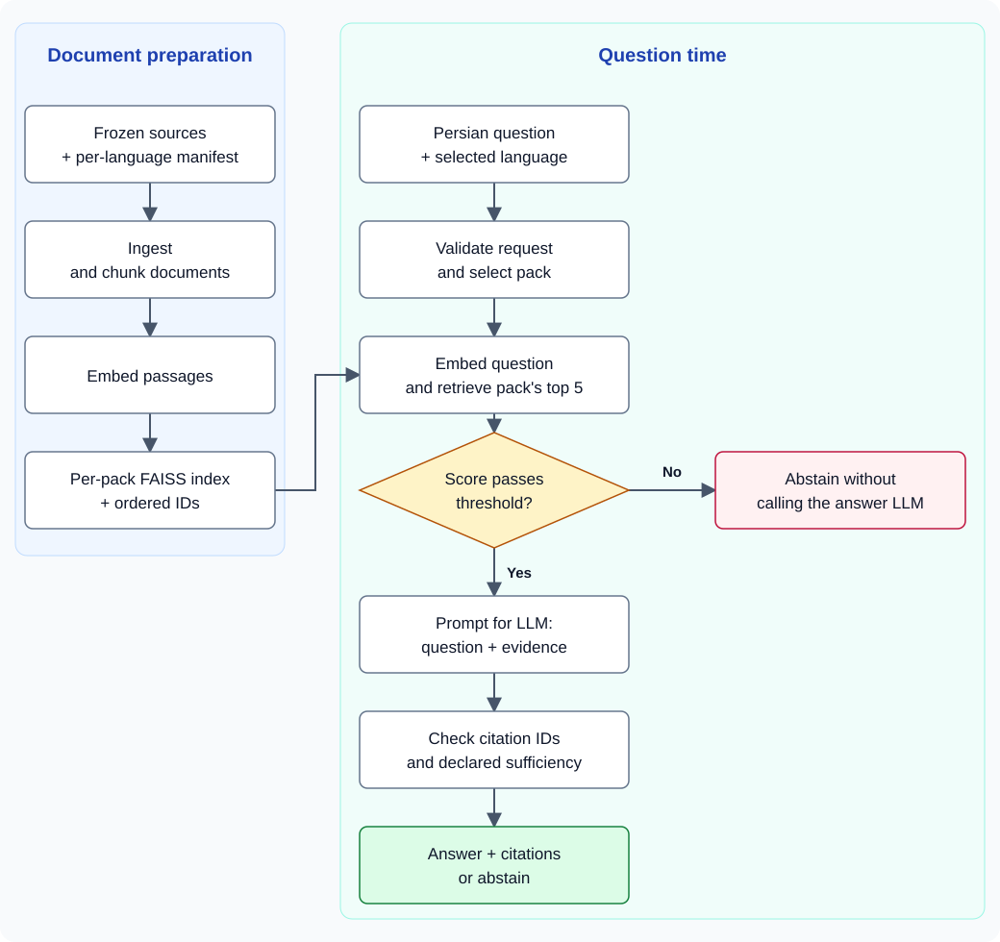

# Persian Technical RAG

**English** | [فارسی](README.fa.md)

<p align="center">
  <strong>Persian questions. Defined sources. Verifiable evidence.</strong><br>
  An open-book technical learning assistant and a research workflow for evaluating retrieval quality.
</p>

<p align="center">
  
  
  
  
  
</p>

**Persian Technical RAG** is an educational and research prototype for answering
Persian questions about **C, C++, Python, and Java**. Instead of sending a question
alone to a language model, it first searches a frozen collection for the selected
programming language and supplies retrieved passages as evidence. Citations let
readers inspect the source title, section, and supporting excerpt.

**At a glance:** 4 independent language packs · 90 source documents · 1,030 chunks · 3 research embedding models · 180 fresh v2 questions

[Overview](#overview) · [Architecture](#architecture) · [Repository](#structure) · [Results](#results) · [Quick start](#quickstart) · [Research](#research-guide) · [Limitations](#limitations)

> [!IMPORTANT]
> This is a **local thesis and research prototype**, not a production-ready or
> general-purpose assistant. A valid citation does not guarantee that every claim
> in an answer is correct. The [known limitations](#limitations) describe this
> version; documenting them does not mean they have been fixed.

<a id="overview"></a>
## Goals and capabilities

The goal is to make Persian technical answers **traceable and measurable**:
students can inspect the evidence, while researchers can separately ask whether
the system retrieved an expected passage and what citations the final answer used.

- **Persian questions with English terminology:** terms such as `malloc`, `range`, and `inheritance` are preserved in the input.
- **Independent language packs:** each LanguagePack has its own sources, index, and evaluation questions.
- **Inspectable citations:** clicking a citation reveals the document title, section, and chunk text.
- **Abstention:** low retrieval scores stop the request before answer generation; the LLM can also declare the evidence insufficient.
- **Persian dashboard:** language selection, sample questions, Markdown and code rendering, and loading/error states.
- **Auditable evaluation:** versioned questions, evidence provenance, JSON and Markdown reports, and separate results for each language.
- **Embedding comparison:** E5-large, E5-base, and BGE-M3 evaluated with shared chunks, separate indices, and pinned research revisions.

### Two workflows, two purposes

| Workflow | Audience | Main configuration |
|---|---|---|
| Operational dashboard | Students and project demonstrations | `multilingual-e5-large`, with an independent index and threshold per pack |
| Research experiments | Embedding-model comparison | Three revision-pinned models, one pooled-v1 threshold per model, and fresh v2 questions |

Selecting BGE-M3 for an experiment does not automatically change the dashboard's
model. The **embedding model finds passages**; the **answer-generating LLM writes
the response**. Neither is trained from scratch in this project.

<a id="architecture"></a>
## Architecture: from documents to answers

**Retrieval-augmented generation (RAG)** uses retrieved passages to support answer
generation. Document preparation is a separate step: the corpus is not chunked and
embedded again for every question.



<details>
<summary>Editable diagram source (Mermaid)</summary>

```text
flowchart TD
    subgraph Prepare["Document preparation"]
        A["Frozen sources + per-language manifest"] --> B["Ingest and chunk"]
        B --> C["Embed passages"]
        C --> D["FAISS index + ordered IDs"]
    end
    subgraph Ask["Question time"]
        E["Persian question + selected language"] --> F["Validate and select pack"]
        F --> G["Embed question and retrieve pack's top 5"]
        D --> G
        G --> H{"Score passes threshold?"}
        H -->|"No"| I["Abstain without calling the answer LLM"]
        H -->|"Yes"| J["Prompt: question + evidence for the LLM"]
        J --> K["Check citation IDs and declared sufficiency"]
        K --> L["Answer + citations, or abstain"]
    end
```

</details>

Very short questions return `clarify`, and an unprepared pack returns
`unavailable`; these branches stop before retrieval. The user explicitly selects
the programming-language pack—the system does not infer it from the question.

| Layer | Tool or method |
|---|---|
| Chunking | Section-oriented Markdown rules in Python |
| Embeddings | Sentence Transformers and multilingual models |
| Search | FAISS `IndexFlatIP` over normalized vectors |
| Answer generation | Environment-configured, OpenAI-compatible Chat API |
| Web | FastAPI + Uvicorn; HTML/CSS/JavaScript without a frontend framework |
| Evaluation | pytest, ID-based scoring, paired bootstrap, and descriptive threshold sweeps |

The main request path is [`src/web/app.py::_ask`](src/web/app.py), retrieval lives
in [`Retriever.retrieve`](src/qa/retriever.py), and prompt/citation handling lives
in [`compose_answer`](src/qa/answer.py). This path does not use an autonomous agent
or an agent framework.

<a id="structure"></a>
## Repository and corpus

```text
Persian-Technical-RAG/
├── src/
│   ├── ingest/                 # Source loading, chunker, and writer
│   ├── index/                  # Embeddings, FAISS, and research cache
│   ├── qa/                     # Retriever, prompt, provider, and abstention
│   ├── web/                    # API, Persian dashboard, and static assets
│   └── eval/                   # Dataset validation, calibration, and comparison
├── data/
│   ├── corpus/                 # Frozen sources and manifest.<lang>.json
│   ├── index/<lang>/           # Operational index, IDs, and chunks
│   ├── research/embedding-compare/<model>/<lang>/
│   └── eval/                   # v1, v2, pilot, calibration, and reports
├── tests/
│   ├── unit/
│   ├── contract/
│   └── integration/
├── specs/                      # Requirements, plans, decisions, and tasks 001–003
├── docs/                       # Research paper, migration, and execution evidence
├── .specify/                   # Project principles and development planning tools
├── requirements.txt
└── pytest.ini
```

A **manifest** records source provenance, snapshot dates, and license labels.
A **chunk** is a retrievable passage; one document can produce multiple chunks.

| Pack | ID | Sources | Chunks | Composition | Snapshot |
|---|---|---:|---:|---|---|
| C | `c` | 52 | 503 | 12 owner-authored notes, 35 cppreference sources, 5 glibc sources | 2026-09-23 |
| C++ | `cpp` | 13 | 201 | 1 owner-authored note and 12 cppreference sources | 2026-10-16 |
| Python | `python` | 9 | 253 | Official English Python documentation | 2026-10-16 |
| Java | `java` | 16 | 73 | English Oracle tutorials | 2026-10-16 |

Python and Java intentionally use English sources, exercising retrieval from
English evidence for Persian questions. See the [corpus manifests](data/corpus/)
for the full inventory.

**What is versioned?** Sources, questions, IDs, configuration, and official v2
reports. Model weights, `chunks.jsonl`, `faiss.index`, and `embeddings-*.npy` arrays
are downloaded or regenerated, not stored in Git. See [`.gitignore`](.gitignore).

<a id="results"></a>
## Recorded results

These are **stored experimental results**, not a promise of identical output on
future runs. Read each number together with its dataset version, threshold, and
execution mode.

### Operational v1 — October 22, 2026

Each pack has 30 questions: 20 in-corpus, 5 mixed Persian/English, and 5
out-of-corpus (OOC). Three independent cross-pack contamination probes are also
evaluated. Each report below has 33 rows and zero model errors.

| Pack | Hit@5 on 25 answerable questions | Citation precision | OOC abstention | Cross-pack probes | Report |
|---|---|---:|---|---|---|
| C | 25/25 — 1.000 | 0.657 | 5/5 | 3/3 | [C v1](data/eval/c/reports/2026-10-22-0748-c-v1.md) |
| C++ | 15/25 — 0.600 | 0.812 | 5/5 | 3/3 | [C++ v1](data/eval/cpp/reports/2026-10-22-0753-cpp-v1.md) |
| Python | 19/25 — 0.760 | 0.602 | 5/5 | 3/3 | [Python v1](data/eval/python/reports/2026-10-22-0758-python-v1.md) |
| Java | 23/25 — 0.920 | 0.706 | 5/5 | 3/3 | [Java v1](data/eval/java/reports/2026-10-22-0802-java-v1.md) |

- **Hit@5:** at least one expected evidence chunk appears in the first five retrieval results. This does not measure answer correctness.
- **Citation precision:** mean expected-ID precision over generated answers, not semantic verification of every sentence.
- **OOC abstention:** correctly declining an out-of-corpus question without citations.
- **3/3 probes:** success on those three specific questions, not proof that every wrong-pack question will be rejected.

The [C migration report](docs/MIGRATION-RESULTS.md) separately explains preserved
retrieval results versus variability in answer-generation precision.

### Research v2 — three embedding models

**180 fresh questions:** 28 in-corpus, 10 mixed, and 7 OOC for each pack.
Each model's threshold was selected before v2 using the four v1 sets: 100
answerable and 20 OOC questions in total. Pilot and v2 questions are not used to
tune that threshold.

| Research model | Vector dimensions | Maximum tokens | Query / passage prefix |
|---|---:|---:|---|
| `e5-large` | 1024 | 512 | `query: ` / `passage: ` |
| `e5-base` | 768 | 512 | `query: ` / `passage: ` |
| `bge-m3` | 1024 | 8192 | None |

Exact revisions and model licenses are recorded in the
[registry](data/eval/model-comparison/models.json). This comparison uses
normalized dense vectors only; BGE-M3's sparse and multi-vector modes are not evaluated.

**Hit@5 — official v2 runs recorded on October 25, 2026:**

| Pack | E5-large / 38 | E5-base / 38 | BGE-M3 / 38 | Per-language decision | Evidence |
|---|---|---|---|---|---|
| C | 26/38 | 21/38 | 27/38 | Inconclusive | [Table](data/eval/c/reports/v2/comparison.v2.md) · [JSON](data/eval/c/reports/v2/comparison.v2.json) |
| C++ | 13/38 | 17/38 | 29/38 | bge-m3 | [Table](data/eval/cpp/reports/v2/comparison.v2.md) · [JSON](data/eval/cpp/reports/v2/comparison.v2.json) |
| Python | 24/38 | 19/38 | 26/38 | Inconclusive | [Table](data/eval/python/reports/v2/comparison.v2.md) · [JSON](data/eval/python/reports/v2/comparison.v2.json) |
| Java | 33/38 | 32/38 | 38/38 | bge-m3 | [Table](data/eval/java/reports/v2/comparison.v2.md) · [JSON](data/eval/java/reports/v2/comparison.v2.json) |

<details>
<summary><strong>v2 citation precision and abstention: all 12 model–pack combinations</strong></summary>

| Pack | Model | Answer count | Citation precision | Fixed-gate OOC abstention | E2E OOC abstention |
|---|---|---:|---:|---|---|
| c | e5-large | 29 | 0.810 | 1/7 | 7/7 |
| c | e5-base | 24 | 0.833 | 1/7 | 7/7 |
| c | bge-m3 | 27 | 0.772 | 6/7 | 7/7 |
| cpp | e5-large | 14 | 0.750 | 0/7 | 7/7 |
| cpp | e5-base | 17 | 0.912 | 0/7 | 7/7 |
| cpp | bge-m3 | 25 | 0.880 | 3/7 | 7/7 |
| python | e5-large | 18 | 0.833 | 6/7 | 7/7 |
| python | e5-base | 12 | 0.792 | 4/7 | 7/7 |
| python | bge-m3 | 18 | 0.861 | 7/7 | 7/7 |
| java | e5-large | 18 | 0.889 | 6/7 | 7/7 |
| java | e5-base | 14 | 0.845 | 7/7 | 7/7 |
| java | bge-m3 | 27 | 0.920 | 7/7 | 7/7 |

Precision is the mean of **per-answer** precision, not total correct citations
divided by total citations. Consider answer counts too: answering fewer questions
can change how precision should be interpreted. The gate checks only the score;
final abstention can additionally benefit from the LLM declaring insufficient evidence.
Confidence intervals, citation counts, mixed/evidence-language slices, and paired
differences are available in the official tables linked above.

</details>

The decision rule uses 10,000 paired bootstrap replicates with seed `20261022`,
95% metric confidence intervals, and approximately 98.33% difference intervals
for the three model pairs within each language. The highest mean alone does not
establish a winner; **inconclusive** does not establish equivalence either.

**No global winner is claimed.** Pooled four-language analysis is exploratory.
Seven OOC questions per language is a small sample; even 7/7 is not a guarantee on
new questions. v1 and v2 are not a direct before/after comparison because their
questions and thresholds differ.

See the [embedding comparison paper](docs/EMBEDDING-COMPARISON.md) for methods,
limitations, reference-answer provenance, and links to all 12 report pairs.

<a id="quickstart"></a>
## Quick start: run the C pack first

This is the shortest setup path to a dashboard with **one prepared pack**, not a
guarantee of short download or processing times. Commands target **Windows,
PowerShell, and Python 3.11** and run from the repository root. Virtual-environment
activation is unnecessary: commands invoke its Python directly.

### Prerequisites

- Git, Python **3.11**, and a browser.
- Internet access for packages and initial embedding-model downloads, plus several GB of free disk space for weights and caches.
- An API key and model name for an OpenAI-compatible Chat service to **generate answers**.
- A GPU was not required for the recorded workflow. Research builds used a CPU-only laptop with about 15.6 GiB RAM; this is not a guaranteed minimum-memory specification.

> [!WARNING]
> Ingest and build commands **write files**. In the current implementation, a
> missing source may only produce a `SKIP` warning and leave incomplete output.
> Check sources and dataset versions before rebuilding an existing index. These
> instructions do not fix that code defect.

### 1. Clone and install

Skip the clone step if you already have the repository:

```powershell
git clone https://github.com/mjmajlesi/Persian-Technical-RAG.git
cd Persian-Technical-RAG

python --version
python -m venv .venv
.\.venv\Scripts\python -m pip install -r requirements.txt
if ($LASTEXITCODE -ne 0) { throw 'Dependency installation failed' }
```

Direct dependencies are pinned; transitive dependencies such as Torch and NumPy
are not fully locked. Check an existing installation with:

```powershell
.\.venv\Scripts\python -m pip check
```

### 2. Configure the answer-generating LLM

Create a local `.env` file at the repository root using an editor. If it already
exists, preserve your settings and update only what is needed. The values below
are **placeholders, not working credentials**:

```dotenv
LLM_API_KEY=<YOUR_API_KEY>
LLM_BASE_URL=https://api.openai.com/v1
LLM_MODEL=<YOUR_CHAT_MODEL>
```

| Variable | Purpose |
|---|---|
| `LLM_API_KEY` | Service API key; never commit it |
| `LLM_BASE_URL` | Service base URL; the provider appends `/chat/completions` |
| `LLM_MODEL` | Answer model name accepted by that service, not the embedding model |
| `LLM_EXPECTED_RESPONSE_MODEL` | Research E2E only: independently verified model ID returned by the API |

For another service, use its valid base URL and model name. Existing process
environment variables take precedence over `.env`. Restart the server after
changing answer-provider settings. Do not rely on `.env.example` in a fresh
clone: it is not versioned.

Without an LLM, you can still prepare sources, build indices, and run
retrieval-only evaluation. Generating answers requires an active service;
requests reaching the LLM may incur charges.

### 3. Check source files before building

This read-only check inspects sources referenced by all four manifests; it does
not load a model or access the network:

```powershell
@'
import json
from pathlib import Path

for lang in ("c", "cpp", "python", "java"):
    path = Path(f"data/corpus/manifest.{lang}.json")
    manifest = json.loads(path.read_text(encoding="utf-8"))
    missing = []
    for source in manifest["sources"]:
        origin = Path(source["origin"])
        if not origin.is_file() or not origin.read_text(encoding="utf-8").strip():
            missing.append(source["source_id"])
    if missing:
        raise SystemExit(f"Missing or empty sources for {lang}: {missing}")
    print(lang, "sources:", len(manifest["sources"]), "OK")
'@ | .\.venv\Scripts\python -B -
if ($LASTEXITCODE -ne 0) { throw 'Source preflight failed; do not ingest' }
```

Expected source counts: C **52**, C++ **13**, Python **9**, and Java **16**, each
marked `OK`. This check does not establish scientific correctness or redistribution rights.

### 4. Build C and start the web app

```powershell
.\.venv\Scripts\python -m src.ingest --lang c
if ($LASTEXITCODE -ne 0) { throw 'C ingest failed' }
if (@(Get-Content -Encoding UTF8 'data/index/c/chunks.jsonl').Count -ne 503) {
    throw 'Unexpected C chunk count; stop before building the index'
}

.\.venv\Scripts\python -m src.index build --lang c
if ($LASTEXITCODE -ne 0) { throw 'C index build failed' }

.\.venv\Scripts\python -m uvicorn src.web.app:app --host 127.0.0.1 --port 8000
```

The first build downloads the embedding model if needed. C should have **503
chunks with 1,024-dimensional embeddings**. A matching count alone does not prove
content or index integrity; research reproduction also requires matching baseline hashes.

Dashboard: **http://127.0.0.1:8000** · API docs: **http://127.0.0.1:8000/docs**

Select C and ask **«تفاوت malloc و calloc چیست؟»** (“What is the difference between
malloc and calloc?”). Click a citation to inspect its evidence. Clicking a
**sample question** submits it automatically and may trigger a paid request;
clicking a **suggested topic after abstention** only fills the question field.
Stop the server with `Ctrl+C`. If you built only C, the other packs being
unavailable is expected.

### 5. Prepare the remaining packs

After the source check succeeds, use another PowerShell window or stop the server:

```powershell
$expectedCounts = @{ cpp = 201; python = 253; java = 73 }
foreach ($lang in 'cpp', 'python', 'java') {
    .\.venv\Scripts\python -m src.ingest --lang $lang
    if ($LASTEXITCODE -ne 0) { throw "Ingest failed: $lang" }
    $count = @(Get-Content -Encoding UTF8 "data/index/$lang/chunks.jsonl").Count
    if ($count -ne $expectedCounts[$lang]) { throw "Unexpected chunk count: $lang" }

    .\.venv\Scripts\python -m src.index build --lang $lang
    if ($LASTEXITCODE -ne 0) { throw "Index build failed: $lang" }
}
```

Restart the server afterward. Pack IDs are `c`, `cpp`, `python`, and `java`;
use `cpp`, not `c++`, on the command line.

<a id="api"></a>
## API usage

| Route | Purpose |
|---|---|
| `GET /` | Dashboard |
| `GET /api/languages` | Packs, availability, and version information |
| `POST /api/ask` | Submit a question and selected language |
| `GET /docs` | Interactive FastAPI documentation |

With the server running, send a request with an explicitly UTF-8-encoded body:

```powershell
$json = @{
    language = 'c'
    question = 'تفاوت malloc و calloc چیست؟'
    top_k = 5
} | ConvertTo-Json
$body = [System.Text.Encoding]::UTF8.GetBytes($json)

Invoke-RestMethod -Uri 'http://127.0.0.1:8000/api/ask' `
    -Method Post -ContentType 'application/json; charset=utf-8' -Body $body
```

`language` defaults to C; `top_k` defaults to 5 and accepts values from 1 to 10.

| Result | Meaning |
|---|---|
| `answer` | Answer text and citations, each containing a title, section, and excerpt |
| `abstain` | Abstention message with no citations |
| `clarify` | Fewer than three words: asks for clarification without retrieval or an LLM call |
| `unavailable` | Registered pack whose sources/index are not ready |
| HTTP `422` | Invalid input or unknown language ID |
| HTTP `500` | For example, missing answer-provider configuration; service errors are not correct abstentions |

Contracts: [Ask API](specs/001-persian-c-qa/contracts/ask-api.md) and
[Languages API](specs/002-multi-language-dashboard/contracts/languages-api.md).
An intended contract is not a guarantee that every implementation branch enforces
it fully; see the limitations below.

<a id="research-guide"></a>
## Research workflow and reproduction

Follow the [full v2 guide](specs/003-compare-embedding-models/quickstart.md).
The sequence is **canonical chunks → hash/ID checks → model×pack indices → locked
v1 gate checks → retrieval-only → optional E2E → report comparison**.

Run one model at a time. A cache hit avoids re-encoding passages, but the build
command can still rewrite FAISS and metadata files.

### Example: E5-large and C

These commands require the canonical chunks. Builds and calibration perform
computation and file writes/checks and may require downloading a model:

```powershell
.\.venv\Scripts\python -m src.index build --lang c --model e5-large
if ($LASTEXITCODE -ne 0) { throw 'Research index build failed' }
```

Gate verification requires **all four research indices for the same model**.
If you have built only C, build the remaining three first:

```powershell
foreach ($lang in 'cpp', 'python', 'java') {
    .\.venv\Scripts\python -m src.index build --lang $lang --model e5-large
    if ($LASTEXITCODE -ne 0) { throw "Research index build failed: $lang" }
}
.\.venv\Scripts\python -m src.eval.calibrate --model e5-large --pooled-v1
if ($LASTEXITCODE -ne 0) { throw 'Locked gate check failed' }
```

The existing record should produce `unchanged locked research gate`. Do not
bypass a mismatch by deleting the record or tuning on v2. The full guide covers
the other two models.

### Replay without LLM calls, in a separate directory

```powershell
$replay = Join-Path ([System.IO.Path]::GetTempPath()) `
    ('persian-rag-replay-' + [guid]::NewGuid().ToString('N'))

.\.venv\Scripts\python -m src.eval run --lang c --model e5-large `
    --set data/eval/c/eval-set.c.v2.json --mode retrieval-only `
    --report-dir "$replay/e5-large/c"
if ($LASTEXITCODE -ne 0) { throw 'Retrieval replay incomplete' }
```

Expected: `retrieval=complete`, `end-to-end=not_run`, 45 rows, and zero retrieval
errors. This makes **zero answer-provider calls**, but still requires the
embedding model and index.

### Optional E2E: service charges may apply

Only proceed after verifying the service and accepting its cost. Determine the
**returned** answer-model ID independently of the requested alias. The value
below is a placeholder, not a ready-to-run setting:

```powershell
$env:LLM_EXPECTED_RESPONSE_MODEL = '<VERIFIED_API_RETURNED_MODEL_ID>'
.\.venv\Scripts\python -m src.eval run --lang c --model e5-large `
    --set data/eval/c/eval-set.c.v2.json --mode end-to-end `
    --report-dir "$replay/e5-large/c"
if ($LASTEXITCODE -ne 0) { throw 'E2E replay incomplete; inspect the report' }
```

Historical reports record `gpt-5.6-sol`; that name does not establish present-day
service availability. Research requests send temperature zero. A stable ID and
temperature zero do not guarantee unchanged weights behind a gateway or identical
future answers.

**Keep replay reports out of official report directories.** Comparison expects
exactly one official report per mode for each model–pack combination. To rebuild
the comparison tables from existing official reports:

```powershell
.\.venv\Scripts\python -m src.eval compare --set-version v2
if ($LASTEXITCODE -ne 0) { throw 'Official comparison validation failed' }
git diff --check
git diff -- data/eval
```

`compare` computes from stored reports without running models or calling an LLM,
but **writes comparison files**. Inspect new differences; do not automatically
replace or commit artifacts. Incomplete E2E runs must retain their errors and
reasons; their metrics are N/A and must not be mixed with complete runs.

<a id="testing"></a>
## Tests and operational evaluation

For a lightweight start, these two files test basic package imports and scoring
without a model or service. `-B` disables bytecode writes, and disabling pytest's
cache provider avoids its cache output:

```powershell
.\.venv\Scripts\python -B -m pytest -p no:cacheprovider `
    tests/unit/test_smoke.py tests/unit/test_scoring.py -q
```

> [!CAUTION]
> The full `pytest tests/` suite is not purely offline unit testing. Some tests
> require a server, a real index/model, or a live provider and may incur charges
> or create temporary files. Multi-GB model-card tests are enabled with
> `RUN_MODEL_CARD_SMOKE=1`.

Once the environment is ready and you accept those prerequisites:

```powershell
.\.venv\Scripts\python -m pytest tests/ -q
```

The historical final validation of feature 003 on **October 25, 2026** recorded
**182 passed, 3 skipped**. See its [evidence and execution boundaries](specs/003-compare-embedding-models/VALIDATION.md).
This is not a fresh result for your installation; skipped tests are not passes.

For operational evaluation of one pack with a configured answer provider—this
command may trigger paid calls:

```powershell
.\.venv\Scripts\python -m src.eval run --lang c
if ($LASTEXITCODE -ne 0) { throw 'Operational evaluation incomplete' }
```

Reports are written to `data/eval/c/reports/`. Local operational JSON is ignored;
official v2 reports are versioned. Check completeness and zero errors before
citing a run. A failed provider response is not a scientifically correct abstention.

<a id="troubleshooting"></a>
## Troubleshooting

| Symptom | Check first |
|---|---|
| `unavailable` or an unprepared pack | Run ingest/build for that pack; check `chunks.jsonl`, `ids.json`, and `faiss.index`. A ready label alone does not prove full integrity. |
| Path not found | Run commands from the repository root; legacy flat paths do not replace `data/index/<lang>/`. |
| LLM configuration error or HTTP 500 | Check the three service variables, model name, and base URL; replace placeholders and restart. Do not share secrets in error reports. |
| Slow first run | Model download/loading or CPU encoding; do not compare cache-hit timing with a fresh build. |
| Short question gets no answer | The current rule clarifies questions shorter than three words; ask a more specific question. |
| `expected one official ... report` | Look for duplicate replay reports in official directories. Keep replays separate; do not delete files blindly. |
| Hash or version mismatch | Stop and compare against the baseline. Settings, text, ID order, and Windows/Linux line endings can affect results. |
| Garbled Persian in API requests | Check UTF-8 body encoding; use the byte-conversion example above. |
| Port 8000 is occupied | Select another port with `--port` and update the browser/API URL. |

<a id="limitations"></a>
## Current limitations and next steps

This version has **known defects**. Important boundaries for use and interpretation:

- **Empty or uncited answers:** the composer can classify empty text or a response
  without citations as an Answer. Citation-ID checks do not establish semantic support.
- **Multi-pack prompt:** the shared prompt still names C; separate indices do not
  automatically fix this instruction weakness for other packs.
- **Ingest and chunking:** missing sources can be skipped; chunk size uses words,
  not actual token limits. Long code blocks can be split, and model inputs can be truncated.
- **Operational model identity:** research checks revisions/hashes more strictly
  than the normal path; the operational model has no explicit research-style revision pin.
- **Web interface:** HTML-entity rendering, late responses during language
  round-trips, and accessibility of clickable controls need improvement. Error-free
  behavior across all browsers is not claimed.
- **Validation boundaries:** duplicate question text within v2 and some cross-report
  citation/identity inconsistencies are not fully rejected. Independently verify
  answer-model consistency and citation membership in fresh runs.
- **Research generalization:** the dataset is small and authored, E5 has prior
  exposure through v1 experimentation, input-length limits differ, and the answer
  service can change. Results do not establish intrinsic or universal superiority.

Development priorities are guards against empty/uncited answers and incomplete
ingest, pack-aware prompts, stronger operational index checks, UI fixes, and edge-case
tests. Larger evaluation sets, token-aware chunking, and other retrieval methods
are subsequent experiments—**future work, not implemented features**.

Authentication, multi-user deployment, production scaling, live web crawling,
and training models from scratch are outside the current scope. See the
[project principles](.specify/memory/constitution.md) before changing that scope.

<a id="documentation"></a>
## Documentation and provenance

| Document | Purpose |
|---|---|
| [Embedding comparison paper](docs/EMBEDDING-COMPARISON.md) | Methods, four primary tables, 12 report pairs, statistics, and source rights |
| [Full research v2 guide](specs/003-compare-embedding-models/quickstart.md) | CPU builds, cache, gates, replay, E2E, and comparison |
| [Research build log](specs/003-compare-embedding-models/index-build-log.md) | Recorded timings, dimensions, and truncated-input counts |
| [Baseline audit](specs/003-compare-embedding-models/baseline-audit.md) | Baseline source hashes and ID order |
| [Final 003 validation](specs/003-compare-embedding-models/VALIDATION.md) | What the historical validation actually checked |
| [C migration report](docs/MIGRATION-RESULTS.md) | What remained stable and what changed after adding packs |
| [Specifications and tasks](specs/) | Decisions and evolution of features 001, 002, and 003 |

### Sources and licenses

Sources are attributed to the note owner, cppreference, Python documentation,
GNU C Library, and Oracle. License labels and dates are recorded in manifests and
question provenance. The research models' MIT licenses **do not license the entire
corpus**. In particular, review Oracle's terms separately before redistributing
substantial text. Attribution or inclusion in this repository is not a blanket
redistribution grant; this collection is not presented under one unified license.

### Changes and issue reports

Include the pack/model ID, dataset version, command, expected behavior, and
observed behavior. Do not share API keys, `.env`, or private service URLs.
Retrieval or answer changes should include tests and before/after evaluation.
Do not silently alter v1/v2 inputs or official reports, and do not tune a threshold
on v2 and reuse that same set to substantiate the comparison claim.
