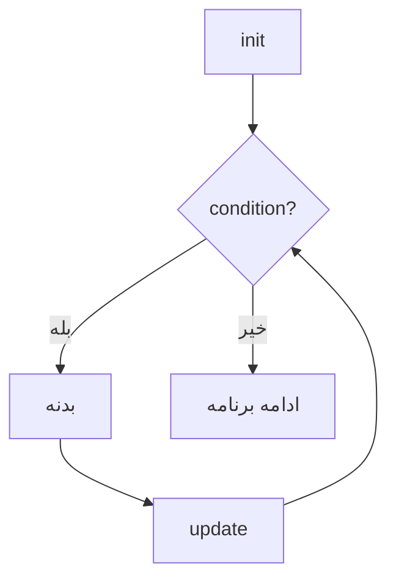

# فصل ۶: دستورهای انتخاب و تکرار

## ۶.۱ — دستور if

```c
if (شرط)
    دستور;        // یا بلوک { ... }
```

اگر شرط **غیرصفر** باشد دستور اجرا می‌شود. (یادآوری فصل ۴: در C صفر=غلط، هر چیز دیگر=درست.)

```c
int score = 17;
if (score >= 10)
    printf("Passed\n");

// با بلوک — وقتی بیش از یک دستور داریم:
if (score >= 10) {
    printf("Passed\n");
    printf("Congrats!\n");
}
```

**سمی‌کولن خالی!**

```c
if (x > 5);
    printf("Big\n");   // همیشه چاپ می‌شود! if تمام شد؛ این دستور مستقل است
```
سمی‌کولن بعد از پرانتز if یعنی «دستور خالی» — شرط فقط همین را کنترل می‌کند. تله کلاسیک کنکوری!


### if / else

```c
if (score >= 10)
    printf("Pass");
else
    printf("Fail");
```

بخش else فقط وقتی شرط غلط است اجرا می‌شود.

### if/else زنجیره‌ای

```c
if (score >= 17)        printf("A");
else if (score >= 14)   printf("B");
else if (score >= 10)   printf("C");
else                    printf("F");
```

مهم: شرط‌ها **به ترتیب** بررسی می‌شوند و اولین شرط برقرار، بقیه را نادیده می‌گیرد. برای score=18 فقط `A` چاپ می‌شود نه همه!

---

## ۶.۲ — if تو در تو و معمای Dangling else ⭐⭐⭐

```c
if (a > 0)
    if (b > 0)
        printf("Both positive");
else
    printf("???");      // این else به کدام if تعلق دارد؟
```

**قانون طلایی**

**هر `else` به نزدیک‌ترین `if` قبلیِ بدون else تعلق دارد** — تورفتگی هیچ نقشی ندارد!


پس مثال بالا معادل این است:

```c
if (a > 0) {
    if (b > 0)
        printf("Both positive");
    else
        printf("a>0 but b<=0");   // else متعلق به if داخلی!
}
```

اگر منظورتان else مربوط به if بیرونی بود، باید آکولاد بگذارید:

```c
if (a > 0) {
    if (b > 0)
        printf("Both positive");
}
else
    printf("a <= 0");
```

```c
int a = -1, b = 5;
if (a > 0)
    if (b > 0)
        printf("X");
else
    printf("Y");
printf("Z");
```
**خروجی:** `Z` — چون else به if داخلی چسبیده؛ a>0 غلط پس کل بلوک if بیرونی (شامل if داخلی و else آن) رد می‌شود.

---

## ۶.۳ — عملگر شرطی ? : (Ternary)

تنها عملگر سه‌عملوندی C؛ جایگزین فشرده if/else:

```c
condition ? value_if_true : value_if_false;

max = (a > b) ? a : b;
abs = (x < 0) ? -x : x;
parity = (n % 2 == 0) ? "Even" : "Odd";
```

- شرکت‌پذیری: **راست‌به‌چپ** ← می‌توان زنجیره کرد:

```c
grade = s >= 17 ? 'A' : s >= 14 ? 'B' : s >= 10 ? 'C' : 'F';
// معادل: s>=17?'A':(s>=14?'B':(s>=10?'C':'F'))
```

- چون یک **عبارت** است (نه دستور)، داخل printf هم می‌آید:

```c
printf("%d is %s\n", n, n % 2 ? "odd" : "even");
```

---

## ۶.۴ — دستور switch ⭐⭐

انتخاب چندراهی بر اساس مقدار صحیح:

```c
#include <stdio.h>

int main(void)
{
    int choice;
    scanf("%d", &choice);

    switch (choice) {
        case 1:
            printf("One\n");
            break;
        case 2:
            printf("Two\n");
            break;
        case 3:
        case 4:                       // fall-through عمدی: ۳ و ۴ یکی
            printf("Three or Four\n");
            break;
        default:
            printf("Other\n");
    }
    return 0;
}
```

### قواعد حیاتی switch

| قاعده | توضیح |
|--------|-------|
| شرط switch باید **صحیح یا کاراکتر** باشد | float/double/string مجاز نیست! |
| مقادیر case باید **ثابت صحیح** باشند | متغیر مجاز نیست؛ `case 1+2:` مجاز است (عبارت ثابت) |
| مقادیر case نباید **تکراری** باشند | خطای کامپایل |
| بدون `break` → **fall-through** | اجرا به caseهای بعدی ادامه می‌یابد تا break یا پایان! |
| `default` اختیاری است | می‌تواند هر جا باشد؛ اگر caseها نخوردند اجرا می‌شود |

### رفتار Fall-Through — پرتکرارترین تله

```c
int x = 2;
switch (x) {
    case 1:  printf("A");
    case 2:  printf("B");
    case 3:  printf("C");
    default: printf("D");
}
```
**خروجی:** `BCD` — چون x=2 با case 2 مطابقت کرد، بدون break همه موارد بعدی هم اجرا می‌شوند!

```c
int y = 9;
switch (y) {
    default: printf("d");
    case 1:  printf("1");
    case 2:  printf("2");
}
```
**خروجی:** `d12` — default اول است ولی فقط وقتی هیچ case نخورد اجرا می‌شود؛ بعد از شروع اجرای default، مثل بقیه fall-through ادامه می‌یابد!

**چه چیزی بین caseها مجاز است؟**

اعلان متغیر بین case ها در C99 مجاز است ولی پرش از روی مقداردهی اولیه‌اش خطرناک/UB است. بهترین تمرین: هر case را داخل `{ }` بگذارید اگر متغیر لازم دارید.


---

## ۶.۵ — حلقه while

```c
while (شرط)
    بدنه;          // تا وقتی شرط غیرصفر است تکرار می‌شود
```

حلقه **pre-test**: شرط **قبل** از بدنه چک می‌شود؛ ممکن است حتی یک بار هم اجرا نشود.

```c
int i = 1, sum = 0;
while (i <= 100) {
    sum += i;
    i++;               // فراموش کردن این = حلقه بی‌نهایت!
}
printf("%d\n", sum);   // 5050
```

سه جزء هر حلقه سالم:
1. **مقداردهی اولیه** (قبل از حلقه): `i = 1`
2. **شرط ادامه:** `i <= 100`
3. **به‌روزرسانی** (داخل بدنه): `i++`

فراموشی مورد ۳ = حلقه بی‌نهایت.

---

## ۶.۶ — حلقه for

```c
for (init; condition; update)
    بدنه;
```

معادل دقیق:

```c
init;
while (condition) {
    بدنه;
    update;
}
```

ترتیب اجرا (حفظ کنید):



```c
for (int i = 1; i <= 5; i++)
    printf("%d ", i);
// خروجی: 1 2 3 4 5
```

### انعطاف‌های عجیب for (منبع سؤال!)

```c
for (;;) { }                 // حلقه بی‌نهایت (همه اجزا اختیاری!)
for (i = 0, j = 10; i < j; i++, j--) ;   // دو متغیر با کاما
for (i = 0; i < 10; i++);    // بدنه‌اش همان ; خالی است — حلقه کار نمی‌کند!
for (i = 0; i++ < 5;) printf("%d", i);   // update خالی؛ شرط خودش i را زیاد می‌کند → 12345
```

**دام سمی‌کولن در for**

`for (...) ;` یعنی بدنه حلقه «دستور خالی» است. دستور بعدی فقط یک بار بعد از پایان حلقه اجرا می‌شود!


### متغیر حلقه در C99

از C99 می‌توانید متغیر را داخل for تعریف کنید (`for (int i = ...)`) — حوزه آن فقط همین حلقه است.

---

## ۶.۷ — حلقه do...while

```c
do {
    بدنه;
} while (شرط);     // ← سمی‌کولن یادت نرود!
```

حلقه **post-test**: بدنه **حداقل یک بار** اجرا می‌شود، بعد شرط چک می‌شود.

```c
int i = 10;
do {
    printf("%d ", i);
    i++;
} while (i < 3);
// خروجی: 10   (یک بار اجرا شد با اینکه شرط از ابتدا غلط بود!)
```

### مقایسه کامل سه حلقه

| ویژگی | while | for | do...while |
|--------|-------|-----|------------|
| زمان چک شرط | قبل از بدنه | قبل از بدنه | **بعد از بدنه** |
| حداقل تعداد اجرا | ۰ | ۰ | **۱** |
| مناسب برای | تکرار نامعلوم | تکرار معلوم | منوها، اعتبارسنجی ورودی |

**تبدیل‌های کنکوری**

- هر while قابل تبدیل به for و بالعکس.
- `for (init; cond; upd) body;` ≡ `init; while (cond) { body; upd; }`
- do...while را نمی‌توان مستقیم به while تبدیل کرد مگر بدنه را قبل از حلقه تکرار کنید.


---

## ۶.۸ — break و continue

### break — خروج فوری از حلقه/سوئیچ

```c
for (int i = 1; ; i++) {
    if (i * i > 500) {
        printf("%d\n", i);    // 23 (اولین عدد که مربعش > 500)
        break;
    }
}
```

break فقط **یک سطح** بالا می‌رود (از حلقه داخلی خارج می‌شود، نه هر دو).

### continue — پرش به تکرار بعدی

```c
for (int i = 1; i <= 10; i++) {
    if (i % 3 != 0)
        continue;             // مضرب ۳ نیست؟ رد شو
    printf("%d ", i);
}
// خروجی: 3 6 9
```

نکته ظریف: در for، بعد از continue باز هم **update اجرا می‌شود** (چون ساختار معادل while است). اما در while، continue به **چک شرط** می‌پرد و اگر update داخل بدنه بعد از continue باشد، اجرا نمی‌شود:

```c
int i = 0;
while (i < 10) {
    i++;
    if (i % 2 == 0) continue;
    printf("%d ", i);
}
// خروجی: 1 3 5 7 9  ✓ (i++ قبل از continue بود)

// اما:
i = 0;
while (i < 10) {
    if (i % 2 == 0) continue;   // i=0 → continue بی‌نهایت! i هرگز تغییر نمی‌کند
    printf("%d ", i);
    i++;
}
```

**جدول مقایسه**

| | break | continue |
|--|-------|----------|
| اثر | خروج از کل حلقه | رد کردن این تکرار |
| در switch | مجاز و رایج | مجاز ولی به‌ندرت مفید |
| در for | به بعد از حلقه می‌پرد | **به update سپس شرط** می‌پرد |


---

## ۶.۹ — حلقه‌های تودرتو

```c
for (int i = 1; i <= 3; i++) {
    for (int j = 1; j <= i; j++)
        printf("*");
    printf("\n");
}
/*
 *
 **
 ***
 */
```

برای تحلیل تست‌ها همیشه **جدول ردیابی** بسازید: ستون i، ستون j، ستون خروجی هر دور.

پیچیدگی: حلقه تودرتوی n×n یعنی $O(n^2)$ تکرار.

---

## ۶.۱۰ — الگوهای کلاسیک (که همیشه سؤال می‌شوند)

### جمع سری‌ها

```c
// 1 + 2 + ... + n
sum = 0;
for (i = 1; i <= n; i++) sum += i;

// 1! + 2! + ... + n!
long fact = 1, sum = 0;
for (i = 1; i <= n; i++) {
    fact *= i;         // فاکتوریل تجمعی — نیازی به حلقه داخلی نیست!
    sum += fact;
}

// 1 - 1/2 + 1/3 - 1/4 + ...  (n جمله)
double sum = 0;
int sign = 1;
for (i = 1; i <= n; i++) {
    sum += sign * 1.0 / i;    // 1.0 حیاتی است!
    sign = -sign;
}
```

### وارونه کردن عدد / تشخیص پالیندروم

```c
int rev = 0, t = n;
while (t > 0) {
    rev = rev * 10 + t % 10;
    t /= 10;
}
// n=1234 → rev=4321
```

### شمارش ارقام

```c
int digits = 0;
do { digits++; n /= 10; } while (n > 0);   // do برای n=0 هم جواب ۱ می‌دهد
```


---

## 💻 تمرین‌های کدنویسی فصل ۶

**تمرین ۱:** برنامه‌ای بنویسید که عدد صحیح مثبت بگیرد و اول بودنش را اعلام کند (با for و break).

**پاسخ تمرین ۱**

```c
#include <stdio.h>

int main(void)
{
    int n, isPrime = 1;              // فرض: اول است
    printf("Enter a positive integer: ");
    scanf("%d", &n);

    if (n < 2) isPrime = 0;
    for (int d = 2; d * d <= n; d++) {   // تا جذر n کافی است
        if (n % d == 0) {
            isPrime = 0;
            break;
        }
    }
    printf(isPrime ? "Prime\n" : "Not prime\n");
    return 0;
}
```
نکته: شرط `d * d <= n` از `d <= sqrt(n)` سریع‌تر است (بدون sqrt و بدون float).


**تمرین ۲:** منویی بنویسید که با do...while تا انتخاب گزینه ۴ تکرار شود (۱: جمع دو عدد، ۲: تفریق، ۳: ضرب، ۴: خروج).

**پاسخ تمرین ۲**

```c
#include <stdio.h>

int main(void)
{
    int choice;
    do {
        printf("\n1)Add 2)Sub 3)Mul 4)Exit : ");
        scanf("%d", &choice);
        if (choice >= 1 && choice <= 3) {
            int a, b;
            scanf("%d %d", &a, &b);
            switch (choice) {
                case 1: printf("= %d\n", a + b); break;
                case 2: printf("= %d\n", a - b); break;
                case 3: printf("= %d\n", a * b); break;
            }
        }
    } while (choice != 4);
    return 0;
}
```
do...while اینجا طبیعی است: منو دست‌کم یک بار باید نمایش داده شود.


**تمرین ۳:** خروجی این برنامه را پیش‌بینی کنید (بدون اجرا!):
```c
#include <stdio.h>

int main(void)
{
    int x = 0;
    for (printf("S"); x < 3 && !printf(""); x++) ;
    printf("|%d", x);
    return 0;
}
```

**پاسخ تمرین ۳**

خروجی: `S|3`

تحلیل عجیب ولی منطقی:
- بخش init فقط یک بار اجرا می‌شود: `printf("S")` ← S چاپ می‌شود.
- شرط: `x < 3 && !printf("")`: printf("") صفر کاراکتر چاپ کرده → برمی‌گرداند ۰ → `!0` = ۱ → پس وقتی `x<3` درست باشد شرط کل درست است!
- پس حلقه سه بار می‌گردد، x=0,1,2 → بعد x=3 شرط غلط.
- بدنه `;` خالی؛ update x++ اجرا می‌شود.
- در پایان: چاپ `|3`.

درس: init در for هر عبارتی می‌تواند باشد (حتی فراخوانی تابع) و printf مقدار برمی‌گرداند!
