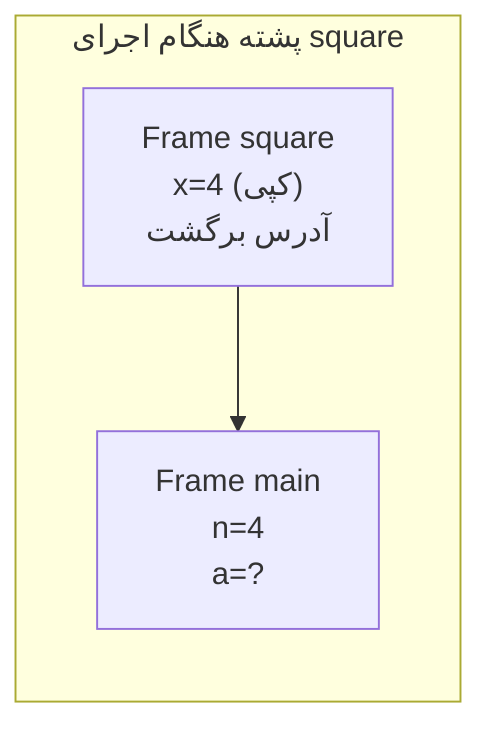
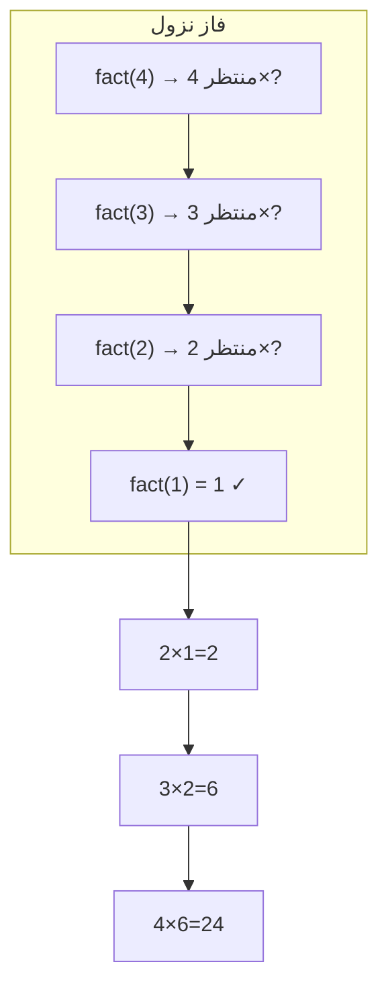

# فصل ۷: توابع

## ۷.۱ — چرا تابع؟

**تابع:** بلوکی مستقل از کد که یک کار مشخص انجام می‌دهد. فواید:

1. **تجزیه مسئله:** تقسیم برنامه بزرگ به ماژول‌های کوچک
2. **عدم تکرار (DRY):** یک بار نوشتن، بارها استفاده
3. **قابلیت استفاده مجدد** و تست مستقل
4. **خوانایی** و نگهداری آسان

```c
#include <stdio.h>

double rectangleArea(double w, double h)      // تعریف تابع
{
    return w * h;
}

int main(void)
{
    double a = rectangleArea(3.5, 2.0);       // فراخوانی
    printf("Area = %.2f\n", a);               // Area = 7.00
    return 0;
}
```

---

## ۷.۲ — آناتومی تعریف تابع

```c
returnType functionName(parameterList)
{
    بدنه؛
    return مقدار;     // اگر returnType غیر void است
}
```

| جزء | نقش | مثال |
|------|-----|-------|
| نوع برگشتی | نوع مقداری که تابع می‌دهد | `int`, `double`, `void` |
| نام | شناسه معتبر | `square` |
| پارامترها | متغیرهای ورودی محلی | `(double x)` |
| بدنه | دستورات داخل `{}` | |
| return | پایان + تحویل مقدار | `return x*x;` |

### قواعد return

- اجرای هر `return` = **پایان فوری تابع**
- تابع `void` بدون return یا با `return;` خالی
- **یک تابع فقط یک مقدار** برمی‌گرداند (برای چند خروجی → اشاره‌گر یا struct — فصل ۹)
- اگر تابع غیر void به مسیری برسد که return ندارد ← رفتار تعریف‌نشده!

```c
int sign(int x)
{
    if (x > 0)  return 1;
    if (x < 0)  return -1;
    return 0;          // مسیر بدون return نگذارید!
}
```

**نکته C89**

در C89 اگر نوع برگشتی را ننویسید، پیش‌فرض `int` است (`foo() {...}`). در C99 حذف شده ولی طراحان هنوز از آن سؤال می‌سازند!


---

## ۷.۳ — اعلان تابع (Prototype)

اگر تابع بعد از main تعریف شود، کامپایلر موقع فراخوانی آن را نمی‌شناسد ← خطا. راه حل: **prototype** (اعلان):

```c
#include <stdio.h>

double area(double, double);        // اعلان: فقط امضا؛ نام پارامتر اختیاری

int main(void)
{
    printf("%.1f\n", area(3, 4));   // OK — کامپایلر امضا را می‌داند
    return 0;
}

double area(double w, double h)     // تعریف واقعی
{
    return w * h;
}
```

**اعلان vs تعریف**

- **اعلان:** امضای تابع + `;` — حافظه نمی‌گیرد. مثل «این تابع وجود دارد».
- **تعریف:** بدنه کامل — جایی که کد واقعی است.

فایل‌های `.h` (header) دقیقاً همین اعلان‌ها را نگه می‌دارند:
```c
// geometry.h
double area(double w, double h);

// main.c
#include "geometry.h"    // اعلان‌ها را وارد می‌کند
```


### پیش‌فرض خطرناک C89

فراخوانی تابعی که **نه اعلان دارد نه تعریف قبلی** ← کامپایلر C89 فرض می‌کند `int func()` است. اگر تابع واقعاً double برگرداند، نتایج غلط/UB! همیشه prototype بنویسید.

---

## ۷.۴ — فراخوانی با مقدار (Call by Value) ⭐⭐⭐

**مهم‌ترین مفهوم فصل:** آرگومان‌ها **کپی** می‌شوند. تغییر پارامتر داخل تابع، هیچ اثری روی متغیر اصلی ندارد!

```c
#include <stdio.h>

void tryToModify(int n)
{
    n = 100;                    // فقط کپی تغییر کرد!
    printf("inside: %d\n", n);
}

int main(void)
{
    int x = 5;
    tryToModify(x);
    printf("outside: %d\n", x); // همچنان ۵!
    return 0;
}
```
**خروجی:**
```text
inside: 100
outside: 5
```

راه واقعی تغییر متغیر بیرونی: ارسال **آدرس** (call by reference با اشاره‌گر — فصل ۹، اشاره‌گرها):

```c
void realModify(int *p) { *p = 100; }
// فراخوانی: realModify(&x);   ← حالا x=100 می‌شود
```

**تست کلاسیک swap**

```c
void badSwap(int a, int b) { int t=a; a=b; b=t; }   // بی‌اثر روی caller!
```
این تابع «کار می‌کند» ولی چیزی را عوض نمی‌کند — چون فقط کپی‌ها جابه‌جا شدند.


---

## ۷.۵ — پشته فراخوانی (Call Stack)

پشت فراخوانی حافظه‌ای است که برنامه برای مدیریت فراخوانی تو در توی تابع‌ها و اطلاعات مربوط به هر اجرای تابع استفاده می‌کند؛ هر تابع یک Stack Frame می‌گیرد و با تمام شدنش آن Frame از Stack خارج می‌شود.




**پیامدهای مهم پشته**

- متغیرهای محلی بعد از پایان تابع **نابود** می‌شوند (بهشان اشاره‌گر نگه دارید ← dangling pointer!)
- بازگشت عمیق ← **Stack Overflow**: پشته معمولاً ۱–۸ MB است
- هزینه فراخوانی: کپی آرگومان‌ها + jump — برای همین تابع‌های کوچک داغ را inline می‌کنند


---

## ۷.۶ — رده‌های ذخیره‌سازی (Storage Classes) ⭐⭐

چهار کلیدواژه: `auto`, `register`, `static`, `extern`

| رده | محل ذخیره | طول عمر | حوزه | مقدار اولیه پیش‌فرض |
|------|-----------|---------|------|---------------------|
| `auto` (پیش‌فرض محلی) | پشته | تا پایان بلوک | بلوک | garbage |
| `register` | ترجیحاً ثبات CPU | تا پایان بلوک | بلوک | garbage |
| `static` محلی | بخش داده | **کل برنامه!** | بلوک | صفر |
| `static` سراسری | بخش داده | کل برنامه | **همان فایل** | صفر |
| `extern` | — (ارجاع) | کل برنامه | کل برنامه | — |

### static محلی — متغیر «حافظه‌دار»

```c
#include <stdio.h>

void counter(void)
{
    static int count = 0;    // فقط بار اول مقداردهی می‌شود!
    count++;
    printf("%d ", count);
}

int main(void)
{
    counter();   // 1
    counter();   // 2
    counter();   // 3   ← مقدار بین فراخوانی‌ها حفظ می‌شود
    return 0;
}
```

- مقداردهی اولیه static فقط **بار اول** انجام می‌شود
- اگر مقدار اولیه ندهید ← خودکار **صفر** (برخلاف auto!)

### extern — اعلام «متغیر در جای دیگر تعریف شده»

```c
// file1.c
int g = 42;                 // تعریف (فضا رزرو شد)

// file2.c
extern int g;               // اعلان: «g جای دیگری هست» — فضا نمی‌گیرد
printf("%d", g);            // 42
```

### register — درخواست ثبات

```c
register int i = 10;             // 
// &i مجاز نیست! (ثبات‌ها آدرس ندارند) — نکته کنکوری کلاسیک
```

---

## ۷.۷ — حوزه‌ها (Scopes) و سایه‌اندازی ⭐

| حوزه | مثال |
|-------|------|
| **بلوک (block)** | متغیر داخل `{}` از اعلان تا انتهای بلوک |
| **تابع (function)** | پارامترها و متغیرهای تابع |
| **فایل (file)** | متغیر سراسری خارج از همه توابع |

### قاعده سایه‌اندازی (Shadowing)

متغیر داخلی، متغیر همنام بیرونی را **می‌پوشاند**:

```c
#include <stdio.h>

int x = 10;                     // سراسری

int main(void)
{
    printf("%d\n", x);          // 10
    int x = 20;                 // سایه‌انداز محلی!
    printf("%d\n", x);          // 20
    {
        int x = 30;
        printf("%d\n", x);      // 30
    }
    printf("%d\n", x);          // 20 (بلوک داخلی تمام شد)
    return 0;
}
```

**خروجی:** `10 20 30 20`

```c
int y = 5;
void f(void)
{
    int y = 99;         // سایه‌گذاری سراسری
    y++;                // ۱۰۰ — سراسری دست نخورد
}

int z = 7;
void g(void)
{
    z++;                // ۸ — چون نسخه محلی نیست، سراسری تغییر کرد
}
```

---

## ۷.۸ — توابع کتابخانه‌ای مهم

### توابع ریاضی (`#include <math.h>`)

| تابع | کاربرد | مثال |
|-------|--------|------|
| `sqrt(x)` | جذر | `sqrt(16)` = 4.0 |
| `pow(x,y)` | توان | `pow(2,10)` = 1024.0 |
| `fabs(x)` | قدرمطلق float | `fabs(-2.5)` = 2.5 |
| `abs(x)` | قدرمطلق صحیح (stdlib.h) | `abs(-3)` = 3 |
| `floor(x)` | گرد به پایین | `floor(3.7)` = 3.0 ، `floor(-3.2)` = **−4.0** |
| `ceil(x)` | گرد به بالا | `ceil(3.2)` = 4.0 ، `ceil(-3.8)` = −3.0 |
| `fmod(x,y)` | باقیمانده اعشاری | `fmod(7.5, 2)` = 1.5 |
| `log(x)` / `log10(x)` | لگاریتم طبیعی/دهدهی | `log(M_E)` = 1 |
| `exp(x)` | e^x | `exp(0)` = 1 |

همه این‌ها ورودی و خروجی **double** دارند.

### توابع تصادفی (`#include <stdlib.h>`)

```c
srand(42);              // seed — فقط یک بار در برنامه!
int r = rand();         // عدد تصادفی [0, RAND_MAX]
int dice = rand() % 6 + 1;      // تاس: ۱ تا ۶
int range = lo + rand() % (hi - lo + 1);   // بازه دلخواه
```

**نکته کنکوری srand/rand**

- بدون `srand`، دنباله اعداد در هر اجرا **یکسان** است (seed پیش‌فرض ۱).
- الگوی رایج: `srand(time(NULL));` با `<time.h>` — هر اجرا دنباله جدید.
- `rand()` شبه‌تصادفی (deterministic) است، نه واقعاً تصادفی.
- فرمول `%6+1`: `%` اول اجرا می‌شود (اولویت بالاتر از `+`) → `[1..6]`.


### توابع زمان (`#include <time.h>`)

```c
time_t now = time(NULL);        // ثانیه‌های از 1970/1/1
clock_t t = clock();            // زمان پردازنده مصرفی
double sec = (double)(clock() - start) / CLOCKS_PER_SEC;
```

---

## ۷.۹ — بازگشت (Recursion) ⭐⭐⭐

تابعی که خودش را فراخوانی کند. دو شرط ضروری:
1. **حالت پایه (Base Case):** شرط توقف
2. **گام بازگشتی:** حرکت به سمت حالت پایه

```c
unsigned long long fact(int n)
{
    if (n <= 1)                    // base case
        return 1;
    return n * fact(n - 1);        // recursive step
}
// fact(4) = 4 * fact(3)
//          = 4 * (3 * fact(2))
//          = 4 * (3 * (2 * fact(1)))
//          = 4 * (3 * (2 * 1)) = 24
```

### تحلیل پشته بازگشت — روش ردیابی دو مرحله‌ای

هر بازگشت دو فاز دارد: **نزول** (فراخوانی‌ها تا base case) و **صعود** (بازگشت مقادیر):



عمق پشته برای fact(n): حدود n frame — برای fact(1000000) کرش (stack overflow).

### مثال‌های کلاسیک

```c
// فیبوناچی بازگشتی — درختی و نمایی!
long fib(int n)
{
    if (n == 0 || n == 1) return n;    // دو حالت پایه
    return fib(n-1) + fib(n-2);
}
// fib(5): fib(4)+fib(3) → fib(3) دوبار محاسبه می‌شود...
// پیچیدگی O(φ^n) ≈ O(1.618^n) — وحشتناک کند برای n بزرگ

// جمع ارقام
int digitSum(int n)
{
    if (n == 0) return 0;
    return n % 10 + digitSum(n / 10);
}

// توان سریع
int power(int base, int exp)
{
    if (exp == 0) return 1;
    return base * power(base, exp - 1);
}
```

### مقایسه بازگشتی و غیربازگشتی

| جنبه | بازگشتی | تکراری (حلقه) |
|-------|----------|----------------|
| خوانایی برای مسائل بازگشتی (درخت، مرتب‌سازی) | عالی | ضعیف |
| حافظه | پشته O(depth) | ثابت |
| سرعت | کندتر (overhead فراخوانی) | معمولاً سریع‌تر |
| خطر | Stack Overflow | حلقه بی‌نهایت |

**قانون تبدیل**

هر تابع بازگشتی را می‌توان با حلقه + پشته صریح بازنویسی کرد. فیبوناچی و فاکتوریل راحت حلقه‌ای می‌شوند؛ پیمایش درخت بدون بازگشت دردناک است.

---

## 💻 تمرین‌های کدنویسی فصل ۷

**تمرین ۱:** تابعی بنویسید `int isPerfect(int n)` که تشخیص دهد n کامل است (مجموع مقسوم‌علیه‌های کوچکتر از خودش برابر خودش، مثل ۶=۱+۲+۳). با آن همه اعداد کامل زیر ۱۰۰۰۰ را چاپ کنید.

**پاسخ تمرین ۱**

```c
#include <stdio.h>

int isPerfect(int n)
{
    int sum = 0;
    for (int d = 1; d <= n / 2; d++)
        if (n % d == 0)
            sum += d;
    return sum == n;
}

int main(void)
{
    for (int n = 2; n < 10000; n++)
        if (isPerfect(n))
            printf("%d ", n);
    printf("\n");
    return 0;
}
```
خروجی: `6 28 496 8128`. تابع `isPerfect` مقدار ۱/۰ برمی‌گرداند — الگوی «تابع گزاره‌ای» که در همه پروژه‌ها لازم می‌شود.


**تمرین ۲:** تابع بازگشتی `int gcd(int a, int b)` (اقلیدس بازگشتی) و نسخه حلقه‌ای آن را بنویسید و مقایسه کنید.

**پاسخ تمرین ۲**

```c
int gcdRecursive(int a, int b)
{
    if (b == 0)          // حالت پایه
        return a;
    return gcdRecursive(b, a % b);   // گام بازگشتی
}

int gcdIterative(int a, int b)
{
    while (b != 0) {
        int r = a % b;
        a = b;
        b = r;
    }
    return a;
}
```
هر دو GCD(48,18)=6. نسخه بازگشتی خواناتر، نسخه حلقه‌ای بدون هزینه پشته. توجه: حالت پایه `b==0` است نه `a==0`.


**تمرین ۳:** برنامه‌ای بنویسید که با `rand` صد بار تاس بیندازد و فراوانی هر وجه را چاپ کند. (با srand(time(NULL)))

**پاسخ تمرین ۳**

```c
#include <stdio.h>
#include <stdlib.h>
#include <time.h>

int main(void)
{
    int freq[7] = {0};           // اندیس ۱ تا ۶ استفاده می‌شود؛ صفر خودکار
    srand((unsigned)time(NULL));

    for (int i = 0; i < 100; i++)
        freq[rand() % 6 + 1]++;

    for (int face = 1; face <= 6; face++)
        printf("Face %d: %d times\n", face, freq[face]);
    return 0;
}
```
پیش‌نگاه آرایه‌ها (فصل بعد): `freq[rand()%6+1]++` — شمارنده تجمعی. انتظار: هر وجه حدود ۱۶–۱۷ بار.
