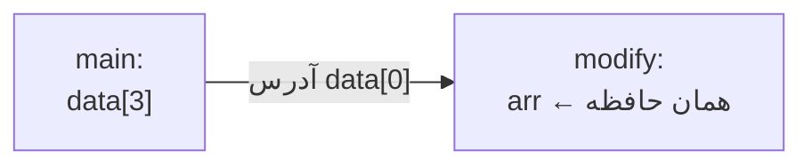

# فصل ۸: آرایه‌ها

## ۸.۱ — آرایه چیست؟

**آرایه:** مجموعه‌ای **متناهی و هم‌نوع** از داده‌ها در خانه‌های **متوالی حافظه** با یک نام مشترک.

```c
int scores[5];              // ۵ خانه int پشت سر هم
scores[0] = 18;             // عنصر اول — اندیس از صفر!
scores[4] = 12;             // عنصر آخر
// scores[5] وجود خارجی ندارد!
```

**قاعده اندیس‌گذاری**

آرایه با n عنصر: اندیس معتبر از **۰** تا **n−۱**. عنصر i-ام یعنی `arr[i-1]`.
دسترسی به هر عنصر O(1) است چون آدرس مستقیم محاسبه می‌شود: `آدرس + i × sizeof(type)`.


### اندازه‌گیری

```c
int arr[10];
size_t n = sizeof(arr) / sizeof(arr[0]);   // 40/4 = 10 — ترفند استاندارد!
```

`sizeof(arr)` کل بایت‌های آرایه؛ تقسیم بر اندازه یک عنصر = تعداد عناصر.

---

## ۸.۲ — تعریف و مقداردهی اولیه

```c
int a[5] = {10, 20, 30, 40, 50};   // کامل
int b[5] = {1, 2};                 // {1,2,0,0,0} — بقیه صفر!
int c[]  = {5, 6, 7};              // اندازه از لیست: ۳
int d[5] = {0};                    // همه صفر — الگوی رایج
int e[3] = {1, 2, 3, 4, 5};        // ⚠️ خطا! عناصر بیشتر از اندازه
int f;                             // متغیر معمولی
int g[3];                          // بدون مقداردهی → مقادیر garbage!
```

قواعد کلیدی:

| حالت | نتیجه |
|-------|--------|
| `{...}` کامل | همان مقادیر |
| `{...}` ناقص | باقی **صفر** |
| `{}` یا `{0}` | همه صفر |
| بدون initializer | **garbage** (محلی) |

**اندازه باید ثابت باشد (تا C99)**

`int n; scanf("%d",&n); int arr[n];` فقط در C99+ مجاز است (VLA). در سرفصل کنکور، اندازه آرایه باید **ثابت زمان کامپایل** فرض شود — معمولاً با `#define SIZE 100`.


### ثابت‌های #define با آرایه‌ها

```c
#include <stdio.h>
#define SIZE 5          // جایگزینی متنی قبل از کامپایل

int main(void)
{
    double data[SIZE];
    for (int i = 0; i < SIZE; i++)
        data[i] = i * 1.5;
    ...
}
```

فایده: تغییر اندازه فقط در یک خط. (`SIZE` پرانتز نشده اگر عبارتی بود خطا می‌دهد — جزئیات در فصل ۱۵، پیش‌پردازنده)

---

## ۸.۳ — پیمایش و عملیات پایه

```c
#include <stdio.h>
#define N 5

int main(void)
{
    int a[N] = {8, 3, 15, 6, 2};
    int max = a[0], min = a[0], sum = 0;

    for (int i = 0; i < N; i++) {
        if (a[i] > max) max = a[i];
        if (a[i] < min) min = a[i];
        sum += a[i];
    }

    printf("max=%d min=%d avg=%.1f\n", max, min, (double)sum / N);
    // max=15 min=2 avg=6.8
    return 0;
}
```

**سرریز اندیس — شایع‌ترین باگ دنیا!**

```c
int a[5];
for (int i = 0; i <= 5; i++)   // ⚠️ i=5 هم اجرا می‌شود!
    scanf("%d", &a[i]);        // نوشته شدن روی حافظه بیرون آرایه
```
C هیچ بررسی مرزی انجام **نمی‌دهد**! نوشتن در `a[5]` ممکن است متغیر دیگری را خراب کند، کرش کند یا حتی بی‌صدا رد شود — رفتار **تعریف‌نشده**. شرط صحیح: `i < 5`.


---

## ۸.۴ — ارسال آرایه به تابع ⭐⭐⭐

```c
double average(int values[], int size);      // اعلان — [] بدون اندازه
double average(int *values, int size);       // کاملاً معادل!

void modify(int arr[])
{
    arr[0] = 999;               // ← آرایه اصلی تغییر می‌کند!!
}

int main(void)
{
    int data[3] = {1, 2, 3};
    modify(data);
    printf("%d", data[0]);      // 999 !
}
```

دو واقعیت حیاتی:

1. آرایه **با آدرس ابتدایش** ارسال می‌شود (کپی نمی‌شود!) — پس تغییر داخل تابع، روی اصلی اثر دارد (**برخلاف متغیر ساده**).
2. تابع **اندازه آرایه را نمی‌داند** — باید جداگانه بفرستید. `sizeof(arr)` داخل تابع اندازه اشاره‌گر است (۴/۸ بایت)، نه آرایه!



**جمع‌بندی طلایی**

| ارسال به تابع | کپی؟ | تغییر اثر می‌گذارد؟ |
|----------------|------|---------------------|
| متغیر ساده `f(x)` | ✓ کپی | ✗ |
| آرایه `f(arr)` | ✗ آدرس | ✓ |


---

## ۸.۵ — جستجوی خطی (Linear Search)

```c
int linearSearch(const int arr[], int size, int key)
{
    for (int i = 0; i < size; i++)
        if (arr[i] == key)
            return i;           // اندیس پیدا شد
    return -1;                  // یافت نشد — قرارداد رایج
}
```

پیچیدگی: بهترین O(1)، بدترین/میانگین O(n).

## ۸.۶ — جستجوی دودویی (Binary Search) ⭐⭐⭐

**شرط لازم: آرایه مرتب!**

```c
int binarySearch(const int arr[], int size, int key)
{
    int low = 0, high = size - 1;
    while (low <= high) {
        int mid = low + (high - low) / 2;   // ضد سرریز؛ معادل (low+high)/2
        if (arr[mid] == key)     return mid;
        else if (key < arr[mid]) high = mid - 1;   // نیمه چپ
        else                     low = mid + 1;    // نیمه راست
    }
    return -1;
}
```

**ردیابی** جستجوی 23 در `{4, 9, 15, 23, 31, 42, 57}`:

| دور | low | high | mid | arr[mid] | تصمیم |
|-----|-----|------|-----|----------|-------|
| 1 | 0 | 6 | 3 | 23 | پیدا شد! ✓ |

جستجوی 42:

| دور | low | high | mid | arr[mid] | تصمیم |
|-----|-----|------|-----|----------|-------|
| 1 | 0 | 6 | 3 | 23 | 42>23 → راست |
| 2 | 4 | 6 | 5 | 42 | پیدا شد ✓ |

**نکات کنکوری دودویی**

- پیچیدگی: **O(log₂ n)** — در هر دور فضای جستجو نصف می‌شود.
- بیشینه مقایسه‌ها برای n عنصر: $\lfloor \log_2 n \rfloor + 1$
- برای ۱۰۰۰ عنصر: حداکثر ~۱۰ مقایسه (در مقابل ۱۰۰۰ در خطی!)
- شرط حلقه دقیقاً `low <= high` است (نه `<`) — تست کلاسیک!
- `mid = (low+high)/2` ممکن است overflow کند؛ فرم امن بالا.


---

## ۸.۷ — مرتب‌سازی ⭐⭐⭐

### Bubble Sort (حباب)

هر جفت مجاور مقایسه؛ بزرگ‌تر «حباب» می‌کند تا انتها.

```c
void bubbleSort(int arr[], int size)
{
    for (int pass = 0; pass < size - 1; pass++) {
        int swapped = 0;
        for (int j = 0; j < size - 1 - pass; j++) {
            if (arr[j] > arr[j + 1]) {         // > صعودی، < نزولی
                int tmp = arr[j];
                arr[j] = arr[j + 1];
                arr[j + 1] = tmp;
                swapped = 1;
            }
        }
        if (!swapped) break;   // بهینه‌سازی: مرتب بود → توقف زودهنگام
    }
}
```

**ردیابی** `{5, 2, 4, 1}`:
```text
pass 0: [2,4,1,|5]
pass 1: [2,1,|4,5]
pass 2: [1,|2,4,5]  ✓
```

- پیچیدگی: بدترین/میانگین **O(n²)**، بهترین O(n) با پرچم swapped
- تعداد مبادله بدترین حالت (وارونه): n(n−1)/2
- **پایدار (Stable)**: ترتیب عناصر مساوی حفظ می‌شود

### Selection Sort (انتخاب)

هر دور کوچک‌ترین را انتخاب و به جلوی آرایه می‌آورد:

```c
void selectionSort(int arr[], int size)
{
    for (int i = 0; i < size - 1; i++) {
        int minIdx = i;
        for (int j = i + 1; j < size; j++)
            if (arr[j] < arr[minIdx])
                minIdx = j;
        if (minIdx != i) {
            int tmp = arr[i];
            arr[i] = arr[minIdx];
            arr[minIdx] = tmp;
        }
    }
}
```

- همیشه O(n²) — حتی اگر مرتب باشد!
- تعداد جابه‌جایی کم: حداکثر n−1 (برای داده گران‌قیمت خوب است)
- **ناپایدار**

### Insertion Sort (درج)

مثل مرتب‌کردن کارت‌های بازی: هر کارت جدید در جای درستش در بخش مرتبِ قبل درج می‌شود.

```c
void insertionSort(int arr[], int size)
{
    for (int i = 1; i < size; i++) {
        int key = arr[i], j = i - 1;
        while (j >= 0 && arr[j] > key) {   // شیفت به راست
            arr[j + 1] = arr[j];
            j--;
        }
        arr[j + 1] = key;
    }
}
```

- بهترین O(n) (تقریباً مرتب)، بدترین O(n²)
- **پایدار** — سریع‌ترین ساده بین سه‌تایی برای داده تقریباً مرتب

### جدول مقایسه (حفظ کن!)

| الگوریتم | بهترین | میانگین | بدترین | پایدار؟ | حافظه |
|-----------|--------|---------|--------|---------|-------|
| Bubble (بهینه) | O(n) | O(n²) | O(n²) | بله | O(1) |
| Selection | O(n²) | O(n²) | O(n²) | خیر | O(1) |
| Insertion | O(n) | O(n²) | O(n²) | بله | O(1) |

**جمله حفظی**

**«انتخاب همیشه دو مربع؛ درج و حباب اگر مرتب، سریع»** — و فقط Selection ناپایدار است.


---

## ۸.۸ — آرایه‌های چندبعدی

```c
int matrix[2][3] = {              // ۲ سطر × ۳ ستون
    {1, 2, 3},
    {4, 5, 6}
};
matrix[1][2] = 99;                // سطر ۱ (دوم)، ستون ۲ (سوم) → 6→99

int partial[3][4] = {{1}, {2, 3}};   // سطر0:{1,0,0,0} سطر1:{2,3,0,0} سطر2:{0,0,0,0}
int auto2d[][2] = {1,2,3,4,5,6};     // اندازه سطرها خودکار: ۳ سطر
```

ذخیره‌سازی **row-major**: سطرها پشت سر هم:
`matrix` در حافظه: `1 2 3 4 5 6` (اول همه ستون‌های سطر ۰، بعد سطر ۱)

آدرس عنصر `[i][j]`: `base + (i×تعدادستون + j) × sizeof(type)`
(به تعداد **سطر** نیاز نیست! نکته کنکوری)

### پیمایش

```c
for (int i = 0; i < rows; i++) {
    for (int j = 0; j < cols; j++)
        printf("%4d", m[i][j]);
    printf("\n");
}
```

### ضرب ماتریسی (کلاسیک پروژه و تست)

```c
// C[m][p] = A[m][n] × B[n][p]
for (int i = 0; i < m; i++)
    for (int j = 0; j < p; j++) {
        c[i][j] = 0;
        for (int k = 0; k < n; k++)
            c[i][j] += a[i][k] * b[k][j];
    }
```

سه حلقه تودرتو ← O(m·n·p). ترتیب اندیس‌ها را حفظ کنید: `a[i][k] * b[k][j]`.

### ارسال ماتریس به تابع

```c
void printMatrix(int m[][3], int rows);   // ستون‌ها الزامی!
// یا:
void printMatrix(int (*m)[3], int rows);
```

**فقط اندازه اولیه اختیاری است**

`int m[][]` نامعتبر؛ `int m[][3]` معتبر. کامپایلر برای محاسبه آدرس `m[i][j]` به تعداد ستون‌ها نیاز دارد (row-major!).


---

## ۸.۹ — الگوهای کلاسیک آرایه

### حذف عنصر از موقعیت p

```c
for (int i = p; i < n - 1; i++)   // شیفت به چپ
    arr[i] = arr[i + 1];
n--;
```

### درج در موقعیت p

```c
for (int i = n; i > p; i--)       // شیفت به راست (از آخر!)
    arr[i] = arr[i - 1];
arr[p] = value;
n++;
```

### وارونه کردن آرایه (in-place)

```c
for (int i = 0, j = n - 1; i < j; i++, j--) {
    int t = arr[i]; arr[i] = arr[j]; arr[j] = t;
}
```

### چرخش (rotate) به راست k گام

```c
// روش ساده: k بار یکی-یکی، یا با آرایه کمکی
int temp[n];
for (int i = 0; i < n; i++)
    temp[(i + k) % n] = arr[i];    // ریاضیات مدولار!
```

---

## 💻 تمرین‌های کدنویسی فصل ۸

**تمرین ۱:** برنامه‌ای بنویسید که n عدد بخواند و **دومین عدد بزرگ** را پیدا کند (بدون مرتب‌سازی، یک گذر).

**پاسخ تمرین ۱**

```c
#include <stdio.h>

int main(void)
{
    int n;
    scanf("%d", &n);
    int a[1000];
    for (int i = 0; i < n; i++)
        scanf("%d", &a[i]);

    int f = a[0], s;
    int hasS = 0;
    for (int i = 1; i < n; i++) {
        if (a[i] > f) {
            s = f;
            f = a[i];
            hasS = 1;
        } else if (a[i] < f && (!hasS || a[i] > s)) {
            s = a[i];
            hasS = 1;
        }
    }
    if (hasS)
        printf("Second largest = %d\n", s);
    else
        printf("All elements equal!\n");
    return 0;
}
```
منطق: اگر عنصر جدید از f بزرگ‌تر باشد، f قبلی می‌شود s. اگر بین f و s باشد فقط s به‌روز می‌شود. حالت «همه برابر» هندل شده — دقت مهندسی! (یک گذر، بدون مرتب‌سازی: O(n).)


**تمرین ۲:** مرتب‌سازی انتخابی را طوری بنویسید که در هر دور، **هم کوچک‌ترین در ابتدا و هم بزرگ‌ترین در انتها** قرار دهد (Selection دوطرفه) و روی `{9, 1, 7, 3, 5}` ردیابی کنید.

**پاسخ تمرین ۲**

```c
void twoWaySelectionSort(int a[], int n)
{
    int left = 0, right = n - 1;
    while (left < right) {
        int minI = left, maxI = left;
        for (int i = left + 1; i <= right; i++) {
            if (a[i] < a[minI]) minI = i;
            if (a[i] > a[maxI]) maxI = i;
        }
        int t = a[left]; a[left] = a[minI]; a[minI] = t;
        if (maxI == left) maxI = minI;      // دام معروف! اگر ماکس همان left بود...
        t = a[right]; a[right] = a[maxI]; a[maxI] = t;
        left++;
        right--;
    }
}
```
ردیابی `{9,1,7,3,5}`: دور ۱: min=1(idx1), max=9(idx0) → جابجایی min با left (9↔1): {1,9,7,3,5}؛ چون maxI==left بود → maxI=minI=1 → جابجایی a[right=4] با a[1] (5↔9): {1,5,7,3,9}.
دور ۲ (left=1,right=3): min=3(idx3)، max=7(idx2) → جابجایی min با left (5↔3): {1,3,7,5,9}؛ جابجایی max با right (7↔5): {1,3,5,7,9} ← مرتب! نتیجه نهایی {1,3,5,7,9}.
**دام معروف:** اگر بعد از جابجایی min، عنصر max جابه‌جا شده بود باید اندیسش اصلاح شود — سطر `if (maxI == left)` همین را هندل می‌کند.


**تمرین ۳:** ماتریس ۴×۴ را از ورودی بگیرید و جمع قطر اصلی، قطر فرعی و ترانهاده (transpose) آن را چاپ کنید.

**پاسخ تمرین ۳**

```c
#include <stdio.h>

int main(void)
{
    int m[4][4], t[4][4];
    int mainDiag = 0, antiDiag = 0;

    for (int i = 0; i < 4; i++)
        for (int j = 0; j < 4; j++)
            scanf("%d", &m[i][j]);

    for (int i = 0; i < 4; i++) {
        mainDiag += m[i][i];
        antiDiag += m[i][3 - i];       // قطر فرعی: ستون = n-1-i
        for (int j = 0; j < 4; j++)
            t[j][i] = m[i][j];         // ترانهاده: سطر↔ستون
    }

    printf("Main diag: %d\nAnti diag: %d\nTranspose:\n", mainDiag, antiDiag);
    for (int i = 0; i < 4; i++) {
        for (int j = 0; j < 4; j++)
            printf("%4d", t[i][j]);
        printf("\n");
    }
    return 0;
}
```
دو فرمول حفظ‌شدنی: قطر فرعی `m[i][n-1-i]` و ترانهاده `t[j][i] = m[i][j]`.
