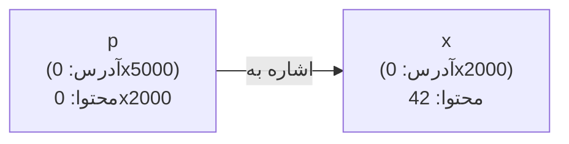

# فصل ۹: اشاره‌گرها

## ۹.۱ — حافظه و آدرس

حافظه RAM مثل خیابانی از خانه‌های یک‌بایتی است؛ هر بایت یک **آدرس** عددی منحصربه‌فرد دارد:

```text
آدرس:    0x1000  0x1001  0x1002  0x1003 ...
محتوا:   [  int x = 42 (۴ بایت)  ]  [char] ...
```

```c
int x = 42;
printf("%p\n", (void*)&x);   // چاپ آدرس x — مثلاً 0x7ffee4c2a89c
```

عملگر `&` (**address-of**): آدرس متغیر را می‌دهد.
(از فصل ۵ یادت هست: `scanf("%d", &x)` دقیقاً همین آدرس را لازم داشت!)

---

## ۹.۲ — تعریف اشاره‌گر و عملگر * 

**اشاره‌گر (Pointer):** متغیری که **آدرس** متغیر دیگری را نگه می‌دارد.

```c
int x = 42;
int *p;          // p اشاره‌گری به int
p = &x;          // p حالا آدرس x را نگه می‌دارد

printf("%p\n", p);     // آدرس x
printf("%d\n", *p);    // 42 — dereference: مقدارِ آن آدرس!
*p = 100;           
printf("%d \n" , x);              // x = 100 شد! (از راه دور!)
```

| نماد | نام                     | کار                   |
| ---- | ----------------------- | --------------------- |
| `&x` | address-of              | آدرس x                |
| `*p` | dereference/indirection | مقدار موجود در آدرس p |

**دو معنای \***

- در تعریف: `int *p;` ← «p یک اشاره‌گر است»
- در عبارت: `*p` ← «مقداری که p به آن اشاره می‌کند»

هر دو عملگر یک‌تایی و اولویت بالا (سطح ۲) با شرکت‌پذیری راست‌به‌چپ.


### تصویر ذهنی



- `p` = 0x2000 (خودِ آدرس)
- `*p` = 42 (مقدار مقصد)
- `&p` = 0x5000 (آدرس خود اشاره‌گر)

### dereference روی اشاره‌گر خطرناک

```c
int *q;            // مقداردهی نشده — garbage!
*q = 5;            // ⚠️ UB! نوشتن در آدرس تصادفی → احتمالاً کرش

int *r = NULL;     // NULL = «به هیچ جا اشاره نمی‌کنم» (stdio.h)
if (r != NULL) *r = 5;   // الگوی امن
*r = 5;            // کرش تضمینی (segfault) — ولی قابل تشخیص
```

**قرارداد طلایی**

اشاره‌گر بدون مقصد را همیشه `NULL` تعریف کنید و قبل از dereference چک کنید.


---

## ۹.۳ — فراخوانی با ارجاع (Call by Reference) ⭐⭐⭐

حل مشکل call-by-value فصل ۷: **آدرس** بفرست، تابع از طریق dereference اصلی را تغییر دهد:

```c
#include <stdio.h>

void swap(int *a, int *b)
{
    int tmp = *a;
    *a = *b;
    *b = tmp;
}

int main(void)
{
    int x = 3, y = 8;
    printf("before: %d %d\n", x, y);
    swap(&x, &y);                    // آدرس‌ها فرستاده می‌شوند!
    printf("after: %d %d\n", x, y);
    return 0;
}
```
**خروجی:**
```text
before: 3 8
after: 8 3
```

تحلیل: `swap(&x,&y)` → a=&x, b=&y → `*a=8` یعنی «خانه‌ای که a نشان می‌دهد (x) را ۸ کن».

الگوی دو-خروجی: C فقط یک return دارد؛ برای چند خروجی، آدرس بفرستید:

```c
void minMax(const int arr[], int n, int *minOut, int *maxOut)
{
    *minOut = *maxOut = arr[0];
    for (int i = 1; i < n; i++) {
        if (arr[i] < *minOut) *minOut = arr[i];
        if (arr[i] > *maxOut) *maxOut = arr[i];
    }
}
// فراخوانی: minMax(data, 10, &lo, &hi);
```

---

## ۹.۴ — رابطه آرایه و اشاره‌گر ⭐⭐⭐ (مهم‌ترین بخش فصل)

**قانون بنیادی:** نام آرایه در اکثر عبارات، به **آدرس عنصر اول** تبدیل (decay) می‌شود:

```c
int a[5] = {10, 20, 30, 40, 50};
int *p = a;              // همان &a[0]
*a == a[0];              // ✓
p[2] == *(p + 2) == *(a + 2) == a[2];   // همه یکی!
```

### چهار نوشتار معادل

| نوشتار | معنی |
|--------|------|
| `a[i]` | عنصر i |
| `*(a + i)` | همان |
| `*(i + a)` | همان (جمع جابه‌جایی‌پذیر است!) |
| `i[a]` | **همان!** (نحو معتبر و عجیب C) |

**تبدیل رسمی اندیس**

کامپایلر `a[i]` را به `*(a+i)` تبدیل می‌کند. پس:
```c
printf("%d", 3["hello"]);   // 'l' — چون "hello" decay به آدرس، 3+آدرس...
```


### استثناهای decay (سه مورد)

نام آرایه در این سه حالت decay **نمی‌شود**:
1. `sizeof(a)` → کل اندازه آرایه (نه اشاره‌گر)
2. `&a` → آدرس **کل آرایه** (عددی همان، اما نوعش متفاوت: `int(*)[5]`)
3. رشته literal داخل initializer

```c
int a[5];
sizeof(a);        // 20 (5×4)
sizeof(a+0);      // 8 — چون decay شد به اشاره‌گر!
sizeof(&a[0]);    // 8
```

**تفاوت ظریف &a و a**

`a` و `&a` و `&a[0]` **همان عدد** را دارند اما نوعشان فرق دارد:
- `a` / `&a[0]`: `int*` — +۱ یعنی پرش ۴ بایت
- `&a`: `int(*)[5]` — +۱ یعنی پرش ۲۰ بایت (کل آرایه!)


---

## ۹.۵ — حساب آدرس (Pointer Arithmetic) ⭐⭐⭐

وقتی به اشاره‌گر عددی اضافه/کم می‌کنید، واحد **اندازه نوع** است، نه بایت:

```c
double d[4] = {1.1, 2.2, 3.3, 4.4};
double *pd = d;

pd + 1        // آدرس pd + 8 بایت (یک double!)
pd + i        // pd + i×sizeof(double)
pd++          // حرکت به عنصر بعدی
```

```text
آدرس‌ها (فرض base=1000):
pd     → 1000  (*pd = 1.1)
pd+1   → 1008  (*pd = 2.2)
pd+2   → 1016  (*pd = 3.3)
```

### عملیات مجاز روی اشاره‌گر

| عملیات | نتیجه | مثال |
|---------|-------|------|
| `p + n`, `p − n` | اشاره‌گر | n عنصر جلو/عقب |
| `p2 − p1` | عدد صحیح (ptrdiff_t) | تعداد عناصر بین دو اشاره‌گر |
| `p1 < p2`, `==`, `!=` | مقایسه | فقط در همان آرایه منطقی است |
| `p += n` | اشاره‌گر | — |

```c
int a[6] = {0,1,2,3,4,5};
int *p1 = &a[1], *p2 = &a[4];

printf("%ld\n", p2 - p1);    // 3  (تعداد عناصر، نه بایت!)
p1 += 2;                     // الان به a[3] اشاره می‌کند
```

**محدودیت‌ها**

- جمع دو اشاره‌گر **غیرمجاز** است (`p1+p2` خطا!)
- ضرب/تقسیم اشاره‌گر ممنوع
- dereference خارج از مرز آرایه = UB
- فقط اشاره‌گر به عنصر **بعد از آخر** (`a+n`) مجاز است نگه داشتنش؛ حتی یک خانه بیشتر UB.


### پیمایش با اشاره‌گر — الگوی حرفه‌ای

```c
void printArray(const int *begin, const int *end)
{
    for (const int *p = begin; p != end; ++p)
        printf("%d ", *p);
}
// printArray(a, a + 5);
// (این دقیقاً الگویی است که STL در ++C استفاده می‌کند!)
```

---

## ۹.۶ — sizeof و اشاره‌گرها

```c
printf("%zu\n", sizeof(int *));      // 8 در سیستم ۶۴ بیتی
printf("%zu\n", sizeof(char *));     // 8
printf("%zu\n", sizeof(double *));   // 8  — همه اشاره‌گرها هم‌اندازه‌اند!
printf("%zu\n", sizeof(struct Big *)); // باز هم ۸
```

**نکته کلیدی**

اندازه **اشاره‌گر** مستقل از نوعی است که به آن اشاره می‌کند (فقط به معماری سیستم بستگی دارد: ۴ بایت در ۳۲-bit، ۸ بایت در ۶۴-bit). چیزی که تغییر می‌کند اندازه‌ی **شیئی است که dereference می‌شود**: `sizeof(*p)` = اندازه نوع.


```c
int a[10];
int *p = a;
sizeof(p);       // 8  (اشاره‌گر)
sizeof(*p);      // 4  (int)
sizeof(a);       // 40 (آرایه کامل — چون decay نشده)
```

---

## ۹.۷ — اشاره‌گر و const (چهار حالت)

| تعریف | اشاره‌گر قابل تغییر؟ | مقدار مقصد قابل تغییر؟ |
|--------|---------------------|--------------------------|
| `int *p` | ✓ | ✓ |
| `const int *p` یا `int const *p` | ✓ | ✗ (pointer to constant) |
| `int * const p` | ✗ | ✓ (constant pointer) |
| `const int * const p` | ✗ | ✗ (هر دو ثابت) |

**ترفند خواندن**

از **راست به چپ** بخوانید:
- `int * const p` ← «const pointer to int»
- `const int * p` ← «pointer to const int»


```c
int x = 5, y = 7;
const int *pc = &x;
pc = &y;             // OK — مقصد عوض شد
*pc = 10;            // ❌ خطا

int * const cp = &x;
cp = &y;             // ❌ خطا
*cp = 10;            // OK

// کاربرد رایج: پارامتر ورودیِ فقط‌خواندنی
size_t myStrlen(const char *s);   // تابع وعده می‌دهد رشته را تغییر ندهد
```

---

## ۹.۸ — آرایه‌ای از اشاره‌گرها

```c
const char *suit[4] = {"Hearts", "Diamonds", "Clubs", "Spades"};

for (int i = 0; i < 4; i++)
    printf("%s\n", suit[i]);
```

هر عضو آرایه یک اشاره‌گر به ابتدای یک رشته است:

```text
suit[0] ──→ "Hearts\0"
suit[1] ──→ "Diamonds\0"
suit[2] ──→ "Clubs\0"
suit[3] ──→ "Spades\0"
```

تفاوت با ماتریس char:

```c
char names2d[4][10];      // بلوک پیوسته ۴۰ بایتی؛ هر رشته حداکثر ۹ حرف
const char *names[4];     // ۴ اشاره‌گر (۳۲ بایت) + رشته‌ها هرجا باشند
```

- آرایه اشاره‌گر: رشته‌ها می‌توانند طول‌های مختلف داشته باشند (صرفه‌جویی)
- ماتریس: طول ثابت ولی پیوسته

### آرگومان main

```c
int main(int argc, char *argv[])   // argv آرایه‌ای از اشاره‌گر به رشته است
{
    for (int i = 0; i < argc; i++)
        printf("arg[%d] = %s\n", i, argv[i]);
    return 0;
}
// ./prog hello world → argc=3, argv[1]="hello" ...
```

---

## ۹.۹ — اشاره‌گر دوبل و اشاره‌گر به تابع

### اشاره‌گر به اشاره‌گر

```c
int x = 7;
int *p = &x;
int **pp = &p;         // pp به اشاره‌گر اشاره می‌کند

printf("%d %d %d\n", x, *p, **pp);   // 7 7 7
**pp = 99;             // x = 99
```

کاربرد واقعی: تغییر دادن خودِ اشاره‌گر داخل تابع (مثل تخصیص حافظه — فصل ۱۴).

### اشاره‌گر به تابع

```c
#include <stdio.h>

int add(int a, int b) { return a + b; }
int mul(int a, int b) { return a * b; }

int main(void)
{
    int (*op)(int, int);       // اشاره‌گر به تابعی (int,int)←int

    op = add;
    printf("%d\n", op(2, 3));  // 5  (فراخوانی غیرمستقیم)

    op = mul;
    printf("%d\n", (*op)(2, 3)); // 6 — * اختیاری است!
    return 0;
}
```

کاربرد: callback، جدول دستورها، qsort سفارشی:

```c
int cmpInt(const void *a, const void *b)
{
    return (*(const int*)a) - (*(const int*)b);
}
qsort(arr, n, sizeof(int), cmpInt);   // کتابخانه stdlib
```

---

## 💻 تمرین‌های کدنویسی فصل ۹

**تمرین ۱:** نسخه اشاره‌گریِ `myStrlen` را بنویسید: `size_t myStrlen(const char *s)` — با پیمایش اشاره‌گری و بدون هیچ اندیس.

**پاسخ تمرین ۱**

```c
size_t myStrlen(const char *s)
{
    const char *start = s;
    while (*s)          // تا رسیدن به \0
        s++;
    return s - start;   // تفریق اشاره‌گر = تعداد کاراکترها
}
```
یا تک‌خطی حرفه‌ای: `while (*s) s++;` سپس برگرداندن فاصله. دقت کنید `const` وعده عدم تغییر می‌دهد و `size_t` نوع استاندارد اندازه‌هاست.


**تمرین ۲:** تابعی بنویسید که آرایه را **in-place** با اشاره‌گرها وارونه کند (بدون اندیس، بدون آرایه کمکی).

**پاسخ تمرین ۲**

```c
void reverse(int *a, size_t n)
{
    int *left = a;
    int *right = a + n - 1;
    while (left < right) {
        int t = *left;
        *left = *right;
        *right = t;
        left++;
        right--;
    }
}
```
دو اشاره‌گر از دو سر به وسط حرکت می‌کنند و در محل مبادله می‌کنند. شرط `left < right` وقتی به هم برسند/رد شوند پایان.


**تمرین ۳:** خروجی برنامه زیر را پیش‌بینی کنید (بدون اجرا):
```c
#include <stdio.h>

int main(void)
{
    int a[4] = {1, 2, 3, 4};
    int *p = a;
    int sum = 0;

    sum += *p++;        /* A */
    sum += (*p)++;      /* B */
    sum += *++p;        /* C */
    printf("sum=%d a1=%d a2=%d\n", sum, a[1], a[2]);
    return 0;
}
```

**پاسخ تمرین ۳**

خروجی: `sum=6 a1=3 a2=3`

تحلیل خط‌به‌خط (تفکیک سه ترکیب دام‌دار):
- **A:** `*(p++)` ← مقدار قدیمی p یعنی a[0]=۱ به sum اضافه؛ بعد p→a[1]. (sum=1)
- **B:** `(*p)++` ← مقدار a[1]=۲ به sum؛ بعد خود a[1] می‌شود ۳. p ثابت مانده. (sum=3, a[1]=3)
- **C:** `*(++p)` ← اول p→a[2]؛ بعد dereference: a[2]=۳ به sum. (sum=6)

جمع: 1+2+3=۶. سه الگوی A/B/C را حفظ باشید — طراحان عاشقشان هستند!
