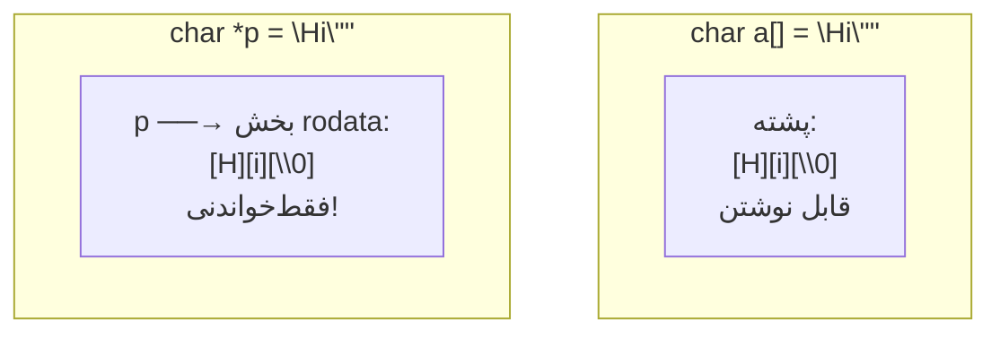

# فصل ۱۰: کاراکترها و رشته‌ها

## ۱۰.۱ — مرور کاراکتر

نوع `char` یک عدد صحیح ۱ بایتی است که کد ASCII را نگه می‌دارد:

| کاراکتر | کد | نکته |
|---------|-----|-------|
| `'0'`–`'9'` | ۴۸–۵۷ | `'5' - '0' = 5` — تبدیل رقم به عدد! |
| `'A'`–`'Z'` | ۶۵–۹۰ | پشت سر هم |
| `'a'`–`'z'` | ۹۷–۱۲۲ | `c - 'a' + 'A'` ← بزرگ کردن حرف |
| `'\n'` | ۱۰ | خط جدید |
| `'\0'` | **۰** | پایانه رشته! |
| `' '` | ۳۲ | فاصله |

**دو ترفند طلایی**

```c
int digit = ch - '0';        // '7' → 7
int index = tolower(ch) - 'a';   // 'd' → 3
```


## ۱۰.۲ — توابع کتابخانه `<ctype.h>`

| تابع | درست وقتی که... | مثال |
|------|------------------|-------|
| `isdigit(c)` | رقم ۰-۹ | `isdigit('7')`=غیرصفر |
| `isalpha(c)` | حرف الفبا | |
| `isalnum(c)` | حرف یا رقم | |
| `isspace(c)` | فاصله/tab/newline | |
| `isupper(c)` / `islower(c)` | بزرگ/کوچک | |
| `ispunct(c)` | علائم چاپی غیرحروف‌رقمی | |
| `iscntrl(c)` | کاراکتر کنترلی | |
| `toupper(c)` | به بزرگ تبدیل | `toupper('a')`=`'A'` |
| `tolower(c)` | به کوچک تبدیل | `tolower('Q')`='q' |

همه یک `int` می‌گیرند و برمی‌گردانند؛ مقدار برگشتی توابع چکی **غیرصفر=درست، صفر=غلط** است.

```c
#include <ctype.h>
char c;
scanf("%c", &c);
if (isupper((unsigned char)c))
    printf("Upper→Lower: %c\n", tolower(c));
else if (isdigit(c))
    printf("Digit value: %d\n", c - '0');
```

## ۱۰.۳ — رشته چیست؟

**رشته = آرایه char + کاراکتر پایانه `'\0'`**

```text
"Hi!" در حافظه:
[H][i][!][\0]
 0  1  2  3   ← اندیس‌ها
```

`\0` (کد صفر) نشانه پایان است؛ همه توابع رشته‌ای به آن تکیه دارند.

### چهار روش تعریف

```c
char s1[] = "Hello";            // 1) اندازه خودکار: ۶ خانه (۵+پایانه)
char s2[10] = "Hi";             // 2) {H,i,\0,...} بقیه صفر
char s3[] = {'H','i'};          // ⚠️ بدون \0 — این رشته نیست، آرایه char خام است!
const char *s4 = "World";       // 3) اشاره‌گر به رشته literal (فقط‌خواندنی!)
```

تفاوت حیاتی ۱ و ۳:

```c
char a[] = "Hi";     // کپی در پشته — قابل تغییر: a[0]='X' ✓
const char *p = "Hi";// literal در بخش فقط‌خواندنی حافظه
p = "Bye";           // ✓ اشاره‌گر جابه‌جا شد
p[0] = 'X';          // ⚠️ UB! نوشتن روی literal ممنوع
```



**تله کلاسیک**

```c
char *s1 = "hello", *s2 = "hello";
// آیا s1 == s2؟ کامپایلر معمولاً یکی ذخیره می‌کند → ممکن است برابر باشند!
char s3[] = "hello";
// s3 == s1؟ قطعاً غلط — s3 کپی جدا دارد.
```
مقایسه رشته‌ها هرگز با `==` انجام نمی‌شود (آدرس‌ها مقایسه می‌شوند نه محتوا!) — باید از `strcmp` استفاده کرد.


### ورودی رشته

```c
char name[20];
scanf("%19s", name);   // نام آرایه خودش آدرس است؛ & اضافه لازم ندارد     
scanf(" %[^\n]", line);   // کل خط با فاصله‌ها
gets(name);               // ❌ مطلقاً ممنوع — هیچ محدودیتی ندارد (سرریز!)؛ از C11 حذف شد
fgets(line, sizeof line, stdin);   // ✓ امن — newline هم می‌گیرد!
```

---

## ۱۰.۴ — توابع `<string.h>` ⭐⭐⭐

| تابع | امضا | کار | برمی‌گرداند |
|-------|------|-----|--------------|
| `strlen(s)` | size_t | طول (بدون \0) | تعداد کاراکترها |
| `strcpy(dst, src)` | | **کپی کامل** src در dst (با \0) | dst |
| `strncpy(dst,src,n)` | | کپی حداکثر n کاراکتر | dst (ممکن است \0 نداشته باشد!) |
| `strcat(dst, src)` | | الحاق src به انتهای dst | dst |
| `strncat(dst,src,n)` | | الحاق حداکثر n | dst |
| `strcmp(s1,s2)` | int | **مقایسه لغت‌نامه‌ای** | <0 / 0 / >0 |
| `strncmp(s1,s2,n)` | int | مقایسه n کاراکتر اول | همان |
| `strchr(s,c)` | | جستجوی کاراکتر c در s | اشاره‌گر به اولین یا NULL |
| `strstr(s1,s2)` | | جستجوی زیررشته | اشاره‌گر یا NULL |

### strcmp دقیق‌تر

مقایسه کاراکتر به‌ کاراکتر تا اولین اختلاف یا \0:

```c
"apple" vs "apple"   → 0        (برابر)
"apple" vs "apples"  → منفی    (اولی کوتاه‌تر/زودتر تمام)
"apple" vs "apply"   → منفی    ('e' < 'y')
"B" vs "a"           → منفی    ('B'=66 < 'a'=97) — بزرگی/کوچکی مهم!
```

**قاعده تست**

`strcmp(a,b)`:
- **۰** ← دو رشته یکسان
- **مثبت** ← a بزرگ‌تر (در لغت‌نامه بعد می‌آید)
- **منفی** ← a کوچکتر

و `if (strcmp(a,b))` یعنی «اگر متفاوت بودند»!


### strlen و sizeof — دوقلوهای فریبکار

```c
char s[20] = "abc";
strlen(s);     // 3  (طول منطقی)
sizeof(s);     // 20 (کل آرایه!)

char t[] = "abc";
sizeof(t);     // 4  (شامل \0)
strlen(t);     // 3 (شامل \0 نمی‌شود)
```

---

## ۱۰.۵ — پیاده‌سازی دستی توابع (سؤال محبوب تشریحی!)

### myStrlen

```c
size_t myStrlen(const char *s)
{
    size_t n = 0;
    while (s[n] != '\0')
        n++;
    return n;
}
```

### myStrcpy

```c
char *myStrcpy(char *dst, const char *src)
{
    char *ret = dst;                 // برای برگرداندن dst طبق قرارداد
    while ((*dst++ = *src++) != '\0')// کپی تا شامل \0؛ حلقه وقتی \0 کپی شد تمام
        ;
    return ret;
}
```

این تک‌خط معروف C را باز کنید: شرط حلقه = نتیجه انتساب = کاراکتر کپی‌شده؛ تا رسیدن به \0 ادامه دارد.

### myStrcmp

```c
int myStrcmp(const char *s1, const char *s2)
{
    while (*s1 && (*s1 == *s2)) {    // تا اختلاف یا پایان
        s1++;
        s2++;
    }
    return (unsigned char)*s1 - (unsigned char)*s2;   // علامتِ اختلاف
}
```

### myStrcat

```c
char *myStrcat(char *dst, const char *src)
{
    char *ret = dst;
    while (*dst)          // ۱) برو به انتهای dst
        dst++;
    while ((*dst++ = *src++))   // ۲) کپی src در ادامه
        ;
    return ret;
}
```

**مسئولیت سرریز با شماست!**

strcpy/strcat هیچ بررسی ظرفیتی ندارند: `strcpy(buf, bigString)` اگر buf کوچک باشد ← **buffer overflow** (باگ امنیتی شماره ۱ تاریخ C!). نسخه‌های امن‌تر: snprintf، strncpy با دقت.


---

## ۱۰.۶ — الگوهای کلاسیک پردازش رشته

### شمارش حروف صدادار

```c
int countVowels(const char *s)
{
    int count = 0;
    for (int i = 0; i < strlen(s); i++)
        switch (tolower((unsigned char)s[i])) {
            case 'a': case 'e': case 'i': case 'o': case 'u':
                count++;
                break;
        }
    return count;
}
```

### وارونه کردن رشته in-place

```c
void strReverse(char *s)
{
    size_t len = strlen(s);
    for (size_t i = 0; i < len / 2; i++) {
        char t = s[i];
        s[i] = s[len - 1 - i];
        s[len - 1 - i] = t;
    }
}
```

### تشخیص پالیندروم (بی‌اعتنا به بزرگی حروف)

```c
int isPalindrome(const char *s)
{
    int l = 0, r = strlen(s) - 1;
    while (l < r) {
        while (l < r && !isalpha((unsigned char)s[l])) l++;   // پرش از غیرحروف
        while (l < r && !isalpha((unsigned char)s[r])) r--;
        if (tolower((unsigned char)s[l]) != tolower((unsigned char)s[r]))
            return 0;
        l++;
        r--;
    }
    return 1;
}
```

### تبدیل عدد رشته‌ای به int (atoi دستی)

```c
int myAtoi(const char *s)
{
    int sign = 1, result = 0;
    while (*s == ' ') s++;              // پرش از فاصله
    if (*s == '-') { sign = -1; s++; }
    else if (*s == '+') s++;
    while (isdigit((unsigned char)*s)) {
        result = result * 10 + (*s - '0');   // الگوی تجمعی هارنر
        s++;
    }
    return sign * result;
}
```

---

## 💻 تمرین‌های کدنویسی فصل ۱۰

**تمرین ۱:** برنامه‌ای بنویسید یک جمله بخواند (خط کامل) و تعداد کلمات آن را بشمارد (کلمه = دنباله حروف/رقمی).

**پاسخ تمرین ۱**

```c
#include <stdio.h>
#include <ctype.h>
int main(void)
{
    char line[200];
    fgets(line, sizeof line, stdin);

    int words = 0, inWord = 0;
    for (int i = 0; line[i] != '\0'; i++) {
        if (!isspace((unsigned char)line[i])) {
            if (!inWord) {
                words++;
                inWord = 1;
            }
        } else {
            inWord = 0;
        }
    }
    printf("Words: %d\n", words);
    return 0;
}
```
منطق پرچم inWord: هر بار از «فضا» به «غیرفضا» می‌رسیم یعنی کلمه جدید شروع شده — حتی چند فاصله پشت هم باشد درست کار می‌کند.


**تمرین ۲:** تابعی بنویسید `void caesarShift(char *s, int k)` که متن را k واحد شیفت سزار بدهد (الفبای انگلیسی چرخشی؛ حروف دیگر دست‌نخورده).

**پاسخ تمرین ۲**

```c
void caesarShift(char *s, int k)
{
    k %= 26;
    if (k < 0) k += 26;
    for (; *s; s++) {
        if (isupper((unsigned char)*s))
            *s = 'A' + (*s - 'A' + k) % 26;
        else if (islower((unsigned char)*s))
            *s = 'a' + (*s - 'a' + k) % 26;
    }
}
```
الگو: فاصله حرف از ابتدای الفبا +k، mod 26، بازگشت به بازه حروف. مدیریت k منفی هم اضافه شد.


**تمرین ۳:** خروجی برنامه زیر را پیش‌بینی کنید:
```c
#include <stdio.h>

int main(void)
{
    char s[] = "2026";
    int num = 0;
    for (int i = 0; s[i]; i++)
        num = num * 10 + (s[i] - '0');
    printf("%d", num / 7);
    return 0;
}
```

**پاسخ تمرین ۳**

خروجی: `289`

حلقه، الگوریتم atoi دستی است: 2→20→202→2026. سپس تقسیم صحیح ۲۰۲۶÷۷ = **۲۸۹** (چون ۷×۲۸۹=۲۰۲۳، باقی ۳).
