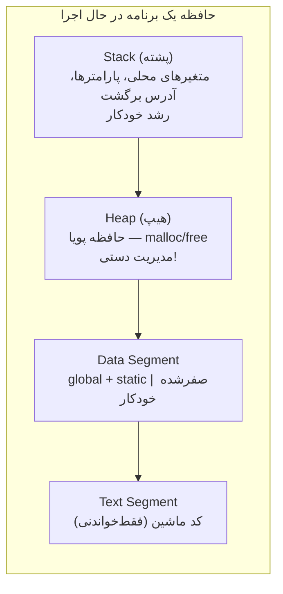

# فصل ۱۴: حافظه پویا و لیست پیوندی

## ۱۴.۱ — نقشه حافظه برنامه



| ناحیه | چه چیزی؟ | طول عمر | مدیریت |
|--------|----------|---------|---------|
| Stack | متغیر محلی/پارامتر | تا پایان بلوک/تابع | خودکار |
| Heap | هرچه malloc کنید | تا free | **شما!** |
| Data | global/static | کل برنامه | خودکار |
| Text | کد | کل برنامه | فقط‌خواندنی |

مشکل پشته: اندازه باید زمان کامپایل معلوم باشد. مشکل هیپ: مدیریت با شماست!

---

## ۱۴.۲ — malloc و free ⭐⭐⭐

```c
#include <stdlib.h>

void *malloc(size_t size);              // تخصیص size بایت؛ محتوا: نامشخص
void free(void *ptr);                   // آزادسازی
```

```c
#include <stdio.h>
#include <stdlib.h>

int main(void)
{
    int n;
    scanf("%d", &n);                    // n موقع اجرا معلوم شد!

    int *arr = malloc(n * sizeof(int)); // الگوی استاندارد
    if (arr == NULL) {                  // همیشه چک!
        fprintf(stderr, "Out of memory\n");
        return 1;
    }

    for (int i = 0; i < n; i++)
        arr[i] = i * i;                 // مثل آرایه عادی استفاده می‌شود
    printf("%d", arr[n - 1]);

    free(arr);                          // آزادسازی — یادتان نرود!
    return 0;
}
```

### چرا `malloc(n * sizeof(int))` و نه `malloc(n*4)`؟
قابل حمل بودن: اندازه int سیستم‌به‌سیستم فرق دارد. ضربدر sizeof همیشه درست است.

### void*: نوع عمومی

`malloc` اشاره‌گر `void*` برمی‌گرداند (به هر نوعی قابل انتساب **بدون cast** در C):

```c
int *p = malloc(10 * sizeof(int));                 // ✓ استایل مدرن
double *d = (double*)malloc(5 * sizeof(double));   // cast اختیاری (استایل قدیمی)
```

**چرا برخی cast می‌کنند؟**

در ++C cast اجباری است. در C اگر فراموش کنید `<stdlib.h>` را include کنید و cast بگذارید، کامپایلر هشدار نمی‌دهد و UB رخ می‌دهد — یکی از دلایلی که استایل بدون cast توصیه می‌شود.


## ۱۴.۳ — calloc، realloc و قواعد طلایی

```c
void *calloc(size_t nmemb, size_t size);
// مثل malloc ولی: تعداد×اندازه + همه را صفر می‌کند!

void *realloc(void *ptr, size_t newsize);
// تغییر اندازه بلوک قبلی (ممکن است جابه‌جا شود!)
```

```c
/* سه روش ساخت آرایه صفرِ ۱۰۰تایی */
int *a1 = calloc(100, sizeof(int));          // ✓ تمیزترین
int *a2 = malloc(100 * sizeof(int));
memset(a2, 0, 100 * sizeof(int));            // بعد از malloc (با string.h)

/* بزرگ کردن آرایه — الگوی امن */
int *tmp = realloc(arr, 200 * sizeof(int));
if (!tmp) { /* arr هنوز معتبر است! */ }
arr = tmp;                                   // فقط بعد از موفقیت
```

**دام realloc**

`arr = realloc(arr, ...)` غلط است اگر شکست بخورد: arr=NULL می‌شود و **بلوک قبلی گم** می‌شود (memory leak)! اول tmp، چک، بعد انتساب.


### قواعد طلایی حافظه پویا (هر تخلف = باگ)

1. هر `malloc/calloc/realloc` دقیقاً یک `free` متناظر دارد
2. free(NULL) مجاز و بی‌اثر است — نیازی به چک قبل از free نیست
3. بعد از free، اشاره‌گر **dangling** است → استفاده = UB. ترفند: `free(p); p = NULL;`
4. **Memory Leak**: فراموشی free یا گم شدن آخرین اشاره‌گر به بلوک
5. **Double Free**: دو بار free همان بلوک = UB
6. malloc محتوای بلوک را **صفر نمی‌کند** (garbage!) — calloc می‌کند

```c
/* leak کلاسیک */
void leaky(void)
{
    char *buf = malloc(1000);
    /* ... */
}                        // ← buf گم شد؛ ۱۰۰۰ بایت نشتی تا پایان برنامه!
```

---

## ۱۴.۴ — آرایه دوبعدی پویا

```c
int r = 4, c = 3;

/* روش ۱: آرایه اشاره‌گرها (سطرهای جدا) */
int **m = malloc(r * sizeof(int *));
for (int i = 0; i < r; i++)
    m[i] = malloc(c * sizeof(int));
// m[i][j] مثل ماتریس معمولی!
/* آزادی: اول سطرها، بعد آرایه اشاره‌گرها */
for (int i = 0; i < r; i++)
    free(m[i]);
free(m);

/* روش ۲: بلوک واحد پیوسته (بهتر برای cache) */
int *flat = malloc(r * c * sizeof(int));
#define M(i,j) flat[(i)*(c)+(j)]     // شبیه‌سازی دو-اندیسی
M(2,1) = 5;                          // معادل m[2][1]
free(flat);
```

---

## ۱۴.۵ — ساختارهای خودارجاع و لیست پیوندی ⭐⭐⭐

**لیست پیوندی:** مجموعه گره‌ها که هر گره شامل داده + **اشاره‌گر به گره بعدی**:

```c
typedef struct Node {
    int data;                 // داده
    struct Node *next;        // اشاره‌گر به گره بعدی — خودارجاعی!
} Node;
```

در مقابل آرایه:

| ویژگی | آرایه | لیست پیوندی |
|--------|-------|--------------|
| دسترسی تصادفی | O(1) | **O(n)** |
| درج/حذف وسط | O(n) شیفت | **O(1)** (با داشتن محل) |
| اندازه | ثابت | پویا |
| حافظه | پیوسته | پراکنده + overhead اشاره‌گر |

```text
head ──→ [10|•]──→[20|•]──→[30|∅]
                            ↑ next آخر NULL است
```

### ساخت و پیمایش

```c
#include <stdio.h>
#include <stdlib.h>

Node *makeNode(int value)
{
    Node *n = malloc(sizeof(Node));
    if (!n) exit(1);
    n->data = value;
    n->next = NULL;          // گره جدید همیشه تهی!
    return n;
}

void printList(Node *head)
{
    for (Node *cur = head; cur != NULL; cur = cur->next)
        printf("%d -> ", cur->data);
    printf("NULL\n");
}
```

```c
/* ساخت 10 -> 20 -> 30 */
Node *head = makeNode(10);
head->next = makeNode(20);
head->next->next = makeNode(30);
printList(head);      // 10 -> 20 -> 30 -> NULL
```

### درج در ابتدا — O(1)

```c
void pushFront(Node **headRef, int value)
{
    Node *n = makeNode(value);
    n->next = *headRef;      // گره جدید به سر قبلی اشاره
    *headRef = n;            // سر جدید = گره ما
}
// فراخوانی: pushFront(&head, 5);   ← &head چون head تغییر می‌کند!
```

**چرا اشاره‌گر دوبل؟**

چون **خود head** باید عوض شود و head متغیری در تابعِ فراخوان است. قانون فصل ۹: برای تغییر X از داخل تابع، آدرس X را می‌فرستید — وقتی X خودش اشاره‌گر است، آدرسش یعنی اشاره‌گر دوبل!


### درج مرتب‌شده و حذف

```c
void insertSorted(Node **headRef, int value)
{
    Node *n = makeNode(value);

    /* پیدا کردن جای درج: اولین گره بزرگتر از value */
    while (*headRef && (*headRef)->data < value)
        headRef = &(*headRef)->next;       // حرکت روی «اشاره‌گرِ» گره‌ها

    n->next = *headRef;
    *headRef = n;                          // درج — حتی در ابتدا هم همین‌طور!
}

void deleteValue(Node **headRef, int value)
{
    while (*headRef) {
        if ((*headRef)->data == value) {
            Node *victim = *headRef;
            *headRef = victim->next;       // دور زدن قربانی
            free(victim);                  // آزادسازی الزامی!
            return;
        }
        headRef = &(*headRef)->next;
    }
}

void freeList(Node *head)
{
    while (head) {
        Node *next = head->next;   // اول ذخیره...
        free(head);                // ...بعد آزاد!
        head = next;
    }
}
```

**ترتیب در freeList**

`free(head); head = head->next;` غلط است — بعد از free، خواندن `head->next` استفاده از حافظه آزادشده (UB)! **اول ذخیره، بعد آزاد.**


---

## ۱۴.۶ — الگوهای تکمیلی پروژه

### پشته با لیست پیوندی

```c
typedef struct SNode {
    int val;
    struct SNode *below;
} SNode;

SNode *top = NULL;

void push(int v) {
    SNode *n = malloc(sizeof(SNode));
    n->val = v;
    n->below = top;
    top = n;
}

int pop(void) {
    if (!top) return -1;             // یا گزارش خطا
    SNode *old = top;
    int v = old->val;
    top = top->below;
    free(old);
    return v;
}
```

### snprintf: ساختن رشته امن

```c
char buffer[64];
snprintf(buffer, sizeof buffer, "User %s has %d points", name, score);
// همیشه \0 می‌گذارد و سرریز نمی‌کند — جایگزین امن sprintf
```

---

## 💻 تمرین‌های کدنویسی فصل ۱۴

**تمرین ۱:** لیست پیوندی بسازید که اعداد ورودی را **به ترتیب مرتب** درج کند، بعد کل لیست و طول آن را چاپ کند و در پایان حافظه را آزاد کند.

**پاسخ تمرین ۱**

```c
#include <stdio.h>
#include <stdlib.h>

typedef struct Node {
    int d;
    struct Node *next;
} Node;

void insertSorted(Node **head, int v)
{
    Node *n = malloc(sizeof(Node));
    if (!n) exit(1);
    n->d = v;
    while (*head && (*head)->d < v)
        head = &(*head)->next;
    n->next = *head;
    *head = n;
}

int length(Node *h)
{
    int len = 0;
    for (; h; h = h->next)
        len++;
    return len;
}

int main(void)
{
    Node *head = NULL;
    int x;
    while (scanf("%d", &x) == 1)
        insertSorted(&head, x);

    for (Node *c = head; c; c = c->next)
        printf("%d -> ", c->d);
    printf("NULL (length=%d)\n", length(head));

    while (head) {
        Node *nx = head->next;
        free(head);
        head = nx;
    }
    return 0;
}
```
ورودی نمونه: `5 2 8 1 7` ← خروجی: `1 -> 2 -> 5 -> 7 -> 8 -> NULL (length=5)`
ترفند `head = &(*head)->next`: حرکت روی «محل نگهداری اشاره‌گر» به‌جای خود گره — درج در ابتدا هم بدون case خاص حل می‌شود.


**تمرین ۲:** برنامه‌ای بنویسید که n عدد بخواند، در آرایه پویا ذخیره کند، میانگین بگیرد و همه اعداد بالاتر از میانگین را چاپ کند. (چرخه کامل تخصیص-استفاده-آزادسازی)

**پاسخ تمرین ۲**

```c
#include <stdio.h>
#include <stdlib.h>

int main(void)
{
    int n;
    scanf("%d", &n);

    double *a = malloc(n * sizeof(double));
    if (!a) return 1;

    double sum = 0;
    for (int i = 0; i < n; i++) {
        scanf("%lf", &a[i]);
        sum += a[i];
    }
    double avg = sum / n;

    printf("avg=%.2f above:", avg);
    for (int i = 0; i < n; i++)
        if (a[i] > avg)
            printf(" %.1f", a[i]);
    putchar('\n');

    free(a);
    return 0;
}
```
چرخه استاندارد پروژه‌های واقعی: درخواست ← چک ← استفاده ← آزادسازی. همین اسکلت را در هر پروژه C تکرار خواهید کرد.
